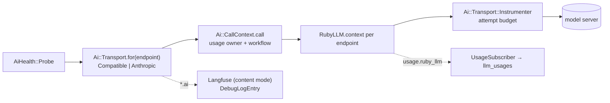
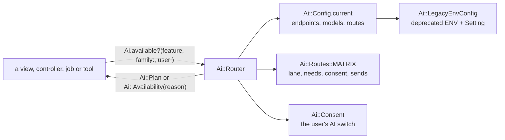

[English](../../../llm-guides/ai-pipeline.md) | **Tiếng Việt** | [Mục lục](../../index.md)

> Bản dịch này chỉ dùng để tham khảo; [tài liệu tiếng Anh gốc](../../../llm-guides/ai-pipeline.md) là nguồn chính sách có hiệu lực. Khi có khác biệt, hãy làm theo bản gốc.

# Pipeline AI

Lời gọi AI của Sure đi qua các lớp transport mỏng trên RubyLLM. Thiết kế nằm trong đề xuất tái cấu trúc hạ tầng AI v0.8 (#4440, `docs/proposals/v0.8/ai-plumbing-redesign.md` trên nhánh đó).

## Transport và cơ chế đo lường

**Vị trí các thành phần**

| Trách nhiệm | File |
|---|---|
| Giá trị endpoint và model mà transport nhận | `app/models/ai/config/endpoint.rb`, `model.rb` |
| Mọi HTTP client, bộ chọn proxy và quy tắc URL cơ sở | `app/models/ai/transport/http.rb` |
| Các transport | `app/models/ai/transport/{base,compatible,anthropic,ruby_llm_adapter}.rb` |
| Lỗi | `app/models/ai/error.rb` |
| Số token và chi phí | `app/models/ai/tokens.rb` |
| Chủ thể chịu mức sử dụng, workflow và hạn mức cho các lần thử của một lời gọi | `app/models/ai/call_context.rb`, `transport/instrumenter.rb` |
| Bản ghi mức sử dụng, nhật ký debug, chế độ tracing và loại bỏ thông tin bí mật | `app/models/ai/instrumentation/*` |

**Quy tắc**

- **Transport không bao giờ đọc ENV, `Setting` hoặc ActiveRecord.** Nó nhận `Ai::Config::Endpoint` và `Ai::Config::Model` do bên gọi tạo.
- **Chỉ tạo client trong `Ai::Transport::Http`.** Thành phần này áp dụng timeout, header, tùy chọn TLS và proxy của endpoint. RubyLLM tự tạo kết nối và không nhận tùy chọn TLS, nên context của nó dùng `Http.ruby_llm_adapter`, một adapter Net::HTTP bổ sung các tùy chọn đó. Contract test sẽ thất bại nếu `OpenAI::Client.new`, `Anthropic::Client.new` hoặc `Faraday.new` xuất hiện ở nơi khác dưới `app/models/ai/`.
- **Chỉ dùng API công khai của RubyLLM**: `RubyLLM.context`, `Context#chat`/`#embed`,
  `Chat#generate`, các setter `with_*`, `RubyLLM::Tool`, `RubyLLM.workflow`,
  `RubyLLM.with_usage_owner`, `RubyLLM::OpenTelemetry.enable`. Không dùng thành phần đánh dấu `:nodoc:`.
  `test/architecture/ai_transport_contract_test.rb` liệt kê những API Sure sử dụng.
- **RubyLLM không bao giờ tự thử lại.** Mọi context đặt `max_retries = 0`; `Ai::Transport::Base#attempt` thử lại khi gặp giới hạn tốc độ, lỗi 5xx và timeout, tối đa theo `max_retries` của endpoint. RubyLLM thử lại bên trong một request mà không có hook trước lần thử tiếp theo, nên chỉ Sure mới có thể dừng khi hết số dư và kiểm tra hạn mức thời gian giữa các lần thử.
- **Chỉ phát sinh `Ai::Error`.** Ánh xạ lỗi client trong transport (`mapping_errors`). Thông báo lỗi đã ánh xạ được loại bỏ thông tin bí mật của endpoint (`Endpoint#secrets`: khóa và các giá trị header tĩnh dài) trước khi được ghi vào bất kỳ nhật ký nào.
- **Bọc mọi lời gọi trong `Ai::CallContext.call`.** Khi đó sự kiện `usage.ruby_llm` của RubyLLM mang thông tin hộ gia đình (chủ thể chịu mức sử dụng) và lời gọi (workflow), còn `UsageSubscriber` ghi một bản ghi
  `llm_usages` cho mỗi request. Bản ghi request thất bại lấy lỗi tương ứng từ sự kiện
  `request.ruby_llm` (`Ai::Transport::Instrumenter`).
- **Không bao giờ tạo `ruby_llm_usages`.** Nếu tạo, sổ ghi của RubyLLM sẽ ghi mỗi lời gọi thêm một lần nữa.

**Kiểm thử**

- `test/support/ai_test_helper.rb`: `ai_endpoint`, `ai_model`, `with_ai_call_context` và
  `capture_ai_events`.
- Transport mới hoặc lời gọi transport mới phải qua `ai_transport_contract_test.rb`: mọi trạng thái HTTP được ánh xạ sang `Ai::Error`, việc thử lại tuân theo endpoint, mức sử dụng tính cả token đã cache và `Http` quyết định proxy.

## Định tuyến và sự đồng ý

**Vị trí các thành phần**

| Trách nhiệm | File |
|---|---|
| Bảng định tuyến: lane, yêu cầu, mức đồng ý và dữ liệu gửi đi của mỗi tính năng | `app/models/ai/routes.rb`, mô tả trong `config/locales/models/ai/en.yml` |
| Thành phần có thể chạy cho một tính năng, hộ gia đình và người dùng, hoặc lý do không thể chạy | `app/models/ai/router.rb`, `ai.rb` (`Ai.available?`, `Ai.availability`, `Ai.plan`) |
| Sự đồng ý | `app/models/ai/consent.rb` |
| Snapshot cấu hình và các route của nó | `app/models/ai/config.rb`, `route.rb` |
| Các biến ENV AI và trường `Setting` đã lỗi thời, được đọc như cấu hình | `app/models/ai/legacy_env_config.rb` |
| Cơ chế bảo vệ controller | `app/controllers/concerns/ai_feature_guard.rb` (`requires_ai`) |
| Cài đặt AI của hộ gia đình | `app/models/family/ai_settings.rb` |

**Quy tắc**

- **Hỏi router, không hỏi nhà cung cấp.** Hiển thị chức năng AI trong view bằng
  `ai_feature_available?(:feature)`, bảo vệ action bằng `requires_ai :feature` và kiểm tra `Ai.available?(:feature, family:, user:)` trong model hoặc job. Không kiểm tra khả năng sử dụng thông qua
  `Provider::Registry`, `Setting` hoặc `VectorStore`.
- **Không đọc ENV AI.** Cop `Sure/NoAiEnv` báo những lần đọc `ENV` có tên giống biến AI bên ngoài
  `Ai::LegacyEnvConfig`; hãy đọc cấu hình AI qua `Ai::Config`. Những file trong allowlist ở `.rubocop.yml` vẫn đọc ENV; danh sách này chỉ được thu hẹp.
- **Tính năng mới là một hàng trong `Ai::Routes::MATRIX`**, với các khóa `sends:` được mô tả tại
  `config/locales/models/ai/en.yml`; khóa tính năng được giữ cố định sau khi phát hành. Sinh lại bảng bên dưới bằng `bin/rails ai:routes_doc`; `ai_routing_matrix_test` thất bại nếu bảng lỗi thời.
- **Sự đồng ý:** trò chuyện và hóa đơn cần công tắc AI của chính người dùng (`users.ai_enabled`); hiện các phần khác chưa cần sự đồng ý.
- **Công cụ AI khai báo tính năng của mình** (`ai_feature :extract_pdf` trên `Assistant::Function`), để chat và MCP chỉ liệt kê công cụ khi tính năng khả dụng.
- **Mỗi tiến trình tạo `Ai::Config` từ ENV riêng**, vì vậy phải cung cấp cùng biến AI cho container web và worker.

<!-- ai:routes_doc -->
| Tính năng | Lane | Yêu cầu | Mục đồng ý | Dữ liệu gửi đi |
|---|---|---|---|---|
| `chat` | interactive | tools, streaming | Trò chuyện (người dùng) | Tin nhắn trò chuyện của bạn; dữ liệu tài chính trợ lý tra cứu để trả lời; văn bản sao kê lưu trong kho của bạn |
| `bill_setup` | interactive | structured_output | Hóa đơn (người dùng) | Ngày giao dịch; số tiền giao dịch; tên giao dịch; tên danh mục của bạn; cài đặt hiện tại của hóa đơn |
| `extract_pdf` | prompt | structured_output | Nhập PDF (người dùng) | Tài liệu bạn tải lên |
| `embed` | prompt | embedding | Tài liệu (người dùng) | Tài liệu bạn tải lên, dưới dạng toàn bộ file gửi tới kho vector hoặc đoạn văn bản gửi tới model embedding |
| `search_documents` | interactive | embedding | Tài liệu (người dùng) | Văn bản tìm kiếm của bạn |
| `categorize` | background | generation: structured_output; judgement: judge | Danh mục (hộ gia đình) | Tên giao dịch; số tiền giao dịch; danh mục ngân hàng gợi ý; tên danh mục của bạn |
| `shadow_categorize` | background | generation: structured_output; judgement: judge | Danh mục (chạy shadow) (hộ gia đình) | Tên giao dịch; số tiền giao dịch; danh mục ngân hàng gợi ý; tên danh mục của bạn |
| `detect_merchants` | background | structured_output | Đơn vị bán hàng (hộ gia đình) | Tên giao dịch; tên đơn vị bán hàng |
| `enhance_merchants` | background | structured_output | Đơn vị bán hàng (hộ gia đình) | Tên đơn vị bán hàng |
<!-- /ai:routes_doc -->

**Kiểm thử**

- `use_ai_routes(categorize: %w[gpu/qwen3-8b openai/gpt-4.1-mini])` định tuyến phần test còn lại qua cấu hình test (`AiTestHelper.test_config`), thay route của những tính năng được nêu;
  `use_no_ai` không cấu hình gì.
- `test/architecture/ai_agreement_test.rb` hỏi mọi điểm vào trong từng cấu hình mà mã nhà cung cấp hỗ trợ (`test/support/ai_legacy_setups.rb`), và thất bại nếu kết quả khác router. Các điểm vào của chat nằm trong allowlist vì chat chưa đi qua router.
- `ai_config_test.rb` kiểm tra luồng ENV cũ định tuyến mỗi tính năng tới đúng nhà cung cấp và model mà mã nhà cung cấp dùng; `ai_feature_guard_test.rb` kiểm tra mọi action khởi chạy tính năng AI đều khai báo `requires_ai`.
