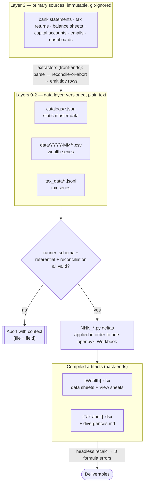
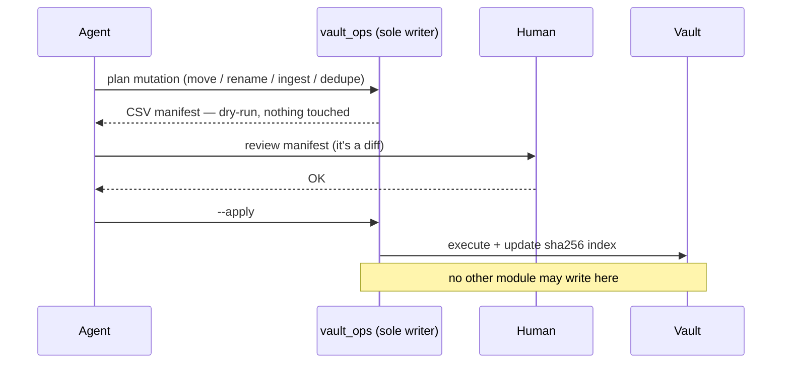
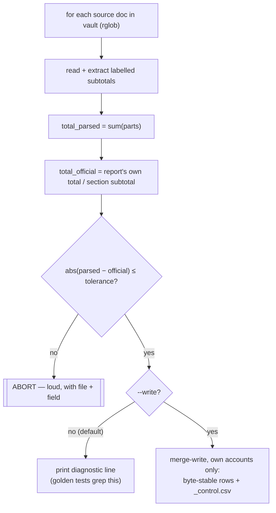
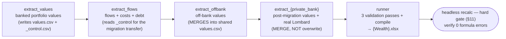

[English](../../../llm-guides/wealth-blueprint.md) | **Tiếng Việt** | [Mục lục](../../index.md)

> Bản dịch này chỉ dùng để tham khảo; [tài liệu tiếng Anh gốc](../../../llm-guides/wealth-blueprint.md) là nguồn chính sách có hiệu lực. Khi có khác biệt, hãy làm theo bản gốc.

> [!NOTE]
> **Tài liệu đặc tả một hệ thống nằm ngoài Sure.** Sure không
> triển khai pipeline, delta đánh số, lớp thuế hoặc bộ sinh Excel
> mô tả ở đây và cũng không có kế hoạch làm vậy. Tài liệu được giữ trong
> repository vì đây là đặc tả harness agent bên ngoài triển khai khi
> dùng Sure làm hệ thống hồ sơ chính thức; đặt trong repository giúp agent có
> checkout Sure đọc được thiết kế mà nó đang thực hiện.
>
> Để hiểu hai bên phối hợp ra sao — lớp nào Sure phụ trách, công cụ MCP nào
> phục vụ phần nào và harness phải tự đảm nhiệm gì — hãy đọc
> [hướng dẫn harness agent tài sản](wealth-agent-harness.md) trước.
>
> Tài liệu gốc được chép nguyên văn như được cung cấp. Không có tên thật,
> tổ chức, vị thế, số tiền hoặc định danh thực.

<!--
  @author        diegomarino @license       MIT © 2026 diegomarino @last-updated  2026-07-29 -->

<a id="blueprint-a-provenance-first-wealth--tax-modelling-system"></a>
# Bản thiết kế: hệ thống mô hình hóa tài sản + thuế ưu tiên nguồn gốc

> **Tài liệu này là gì.** Tài liệu thiết kế tái sử dụng — một “meta-prompt” — dành cho agent tự chủ (hoặc
> lập trình viên) muốn tái tạo hệ thống chúng tôi đã xây: mô hình tài sản và nghĩa vụ thuế hộ gia đình
> có thể kiểm toán, được biên dịch *hoàn toàn* từ tài liệu sơ cấp (sao kê ngân hàng, tờ khai thuế,
> bảng cân đối công ty, tài khoản vốn, email) thành hai sản phẩm: **Excel tài sản**
> và **Excel kiểm toán thuế + báo cáo sai khác**, trong đó *từng con số đều truy được
> về tài liệu nguồn*.
>
> **Tài liệu này không chứa gì.** Không có tên thật, ngân hàng, vị thế, số tiền, số tài khoản, mã thuế,
> ISIN hoặc đường dẫn thực. Mọi thông tin định danh là `{PLACEHOLDER}`. Đây là *cách làm* và
> *lý do*, đã loại dữ liệu cụ thể. Xem bảng placeholder ở §21.
>
> **Cách dùng.** Đọc một lượt từ đầu đến cuối. Sau đó dùng §20 (kế hoạch tái tạo) làm
> kế hoạch thực hiện: mỗi giai đoạn có điều kiện đầu vào, sản phẩm bàn giao và kiểm thử nghiệm thu. Mọi phần
> trước §20 là đặc tả các giai đoạn triển khai. Khi phân vân, §2 (nguyên tắc) được ưu tiên
> hơn mọi phần khác.

---

<a id="contents"></a>
## Mục lục

- [0. Miền nghiệp vụ trong một đoạn (ẩn danh)](#0-the-one-paragraph-domain-anonymized)
- [1. Công nghệ và quy mô hệ thống](#1-tech-stack--system-sizing-calibration)
- [2. Nguyên tắc không thể thỏa hiệp](#2-non-negotiable-principles-the-spine)
- [3. Cấu trúc repository](#3-repository-layout)
- [4. Kiến trúc phân lớp](#4-the-layered-architecture)
- [5. Chi tiết lớp dữ liệu](#5-the-data-layer-in-detail)
- [6. Từ điển dữ liệu (đặc tả đầy đủ các cột)](#6-data-dictionary-full-column-specs)
- [7. Schema và ba lượt xác thực](#7-schemas--the-three-validation-passes)
- [8. Kho tài liệu (lớp 3)](#8-the-document-vault-layer-3)
- [9. Mẫu extractor (bộ phân tích)](#9-the-extractor-pattern-parsers)
- [10. Bộ biên dịch delta đánh số](#10-the-numbered-delta-compiler)
- [11. Bộ sinh Excel](#11-the-excel-generators)
- [12. Lớp thuế](#12-the-tax-layer)
- [13. Chính sách ước tính và khoảng trống](#13-estimation--gap-policy)
- [14. Kiểm thử và xác thực](#14-testing--validation)
- [15. Build định kỳ và quy trình hằng tháng](#15-the-recurring-build--the-monthly-runbook)
- [16. Ví dụ một tháng từ đầu đến cuối](#16-a-worked-month-end-to-end)
- [17. Quy trình vận hành agent](#17-agent-operating-protocol-how-the-builder-works)
- [18. Bài học được khái quát hóa](#18-lessons-learned-generalized)
- [19. Phản mẫu (điều không nên làm)](#19-anti-patterns-what-not-to-do)
- [20. Kế hoạch tái tạo theo giai đoạn và tiêu chí nghiệm thu](#20-replication-plan-phased-with-acceptance-criteria)
- [21. Thuật ngữ và placeholder](#21-glossary-of-placeholders-and-terms)

---

<a id="0-the-one-paragraph-domain-anonymized"></a>
## 0. Miền nghiệp vụ trong một đoạn (ẩn danh)

Chúng tôi mô hình hóa giá trị tài sản ròng của **ba chủ sở hữu độc lập**: hai cá nhân (`{OWNER_A}`,
`{OWNER_B}`) và một công ty holding (`{ENTITY_C}`), cấu hình tài sản tư nhân thông thường (một cặp vợ chồng, công ty holding gia đình, mỗi người một tài khoản tại ngân hàng tư nhân, công ty môi giới và robo-advisor). Tài sản gồm danh mục được quản lý tại ngân hàng/môi giới (`{BROKER}`, `{PRIVATE_BANK}`, `{ROBO_ADVISOR}` có đơn vị lưu ký riêng), hạn mức tín dụng Lombard thế chấp bằng các danh mục đó, bất động sản và nhiều **khoản nắm giữ trực tiếp ngoài ngân hàng** (quỹ mạo hiểm, cổ phần startup, công ty hoạt động), định giá theo giá vốn/giá trị thuế thay vì thị trường. Trên mô hình tài sản là **lớp thuế**: giá trị từng đầu tư trực tiếp tại ngày 31 tháng 12 mỗi năm theo tiêu chí định giá *thuế*, dùng tái dựng và kiểm tra chéo tờ khai thuế tài sản năm (`{WEALTH_TAX_FORM}`). Chi tiết nghiệp vụ đó không quyết định khả năng tái tạo *hệ thống*: có thể thay bằng danh mục tài sản đa dạng có tài liệu chứng minh như bộ sưu tập nghệ thuật, danh mục bất động sản hoặc ngân quỹ doanh nghiệp.

---

<a id="1-tech-stack--system-sizing-calibration"></a>
## 1. Công nghệ và quy mô hệ thống

Hệ thống được chủ ý giữ đơn giản về công nghệ. Tái tạo *cấu trúc*, không cần đúng thương hiệu:

| Thành phần | Lựa chọn | Lý do |
|---|---|---|
| Ngôn ngữ | Python 3, bắt buộc `venv`, dependency ghim trong `requirements.txt` | Phổ biến; agent viết tốt |
| Sinh workbook | `openpyxl` | Ghi bảng có tên và công thức mà không cần cài Excel |
| Kiểm chứng công thức | Script tính lại bằng LibreOffice headless | Chứng minh **không có lỗi công thức** trước khi bàn giao |
| Xác thực schema | `jsonschema` (draft-07) | Một hợp đồng mỗi bảng, kiểm tra trước biên dịch |
| Trích văn bản PDF | `pdftotext` (poppler) + bộ giải mã glyph riêng cho PDF bất thường (§9.2) | Xử lý gần như mọi sao kê |
| Điều tra qua email | Himalaya (khuyến nghị), CLI IMAP chỉ đọc; thông tin xác thực chỉ nằm trong cấu hình riêng (§9.3) | Tái dựng sự kiện chỉ tồn tại trong thư từ |
| Lưu trữ | CSV + JSON/JSONL, văn bản thuần trong Git | `git diff` *chính là* nhật ký thay đổi (§5.3) |
| Điều phối | Hai script Python thuần (`build_all`, `tax_runner`) | Không framework; thứ tự tường minh |

Quy mô thiết kế này xử lý thoải mái (để biết trường hợp của bạn có tương tự không; lớn gấp 100 lần thì xem lại §5.3):

- Vài chục tài khoản trong sổ đăng ký, một số ít chủ sở hữu, vài chục vị thế ngoài ngân hàng.
- Vài chục kỳ tháng, hàng trăm hàng giá trị, dưới một nghìn công thức workbook.
- Vài nghìn tài liệu trong kho, lập chỉ mục bằng SHA-256.
- Vài trăm hàng định giá thuế qua một số năm thuế.
- Build lại toàn bộ từ nguồn: vài giây tới vài phút. Bộ test khoảng 100 test, dưới một phút.

CLI của hệ thống hoàn chỉnh (*toàn bộ* giao diện vận hành):

```
python src/tools/build_all.py            # regenerate EVERYTHING from sources → wealth .xlsx
python src/runner.py --check             # fast gate: validate catalogs + data, write nothing
python src/runner.py                     # validate, then compile the workbook
python src/tools/extract_{source}.py     # one extractor: diagnostic (parse+check, no write)
python src/tools/extract_{source}.py --write   # …and persist to the data layer
python src/tools/tax_runner.py           # tax pipeline → audit .xlsx + divergences.md
python src/tools/tax_crosscheck.py       # 31-Dec wealth ↔ tax cross-check (§12)
python src/tools/vault_doctor.py         # re-hash vault vs index: missing/unindexed/changed
python src/tools/intel_ops.py seed       # skeleton dossiers for every cataloged position (§9.5)
python src/tools/intel_ops.py delta …    # apply a DOSSIER DELTAS block, append-only (§9.5)
python src/tools/vault_ops_cli.py plan …       # vault mutation → dry-run CSV manifest
python src/tools/vault_ops_cli.py --apply …    # execute a human-approved manifest
python -m unittest discover -s tests     # golden + schema + (where sources exist) re-parse tests
```

---

<a id="2-non-negotiable-principles-the-spine"></a>
## 2. Nguyên tắc không thể thỏa hiệp

Đây là các bất biến. Phần còn lại là cách triển khai. Bản tái tạo chỉ giữ được các nguyên tắc này đã đạt 80% giá trị.

1. **Nguồn và sản phẩm biên dịch.** Excel là *đầu ra build*, như binary. Không sửa tay, không dùng làm nguồn chuẩn. Nguồn gồm **delta đánh số bất biến** (`NNN_*.py`) và **lớp dữ liệu** (danh mục JSON, chuỗi thời gian CSV/JSONL). Một lệnh sinh lại toàn workbook từ nguồn.

2. **Không bịa dữ liệu.** Mọi giá trị có `source: {document}, {date}, {reference}`. Không nguồn thì không có hàng; ghi khoảng trống *tường minh* là `PENDING`, không âm thầm điền. “Không có trong hồ sơ” là câu trả lời hợp lệ và cần thiết.

3. **Đối soát hoặc dừng.** Khi có tổng chính thức (ô tổng tờ khai, tổng con bảng cân đối, tổng báo cáo), parser so tổng các phần trích được với tổng đó trong dung sai cấu hình; nếu không khớp, **dừng kèm ngữ cảnh** file/trường. Không để kỳ sai lọt qua âm thầm.

4. **Một cấp độ chi tiết đủ dùng cho câu hỏi tương lai.** Hàng nguyên tử trong bảng giá trị là
   `account × month × asset-class`. Đủ chi tiết để mọi kịch bản/tổng hợp là `GROUP BY`, không cần phân tích lại. Chọn cấp độ không che mất câu hỏi tương lai có thể dự liệu.

5. **Dữ liệu gọn chuẩn; tổng chỉ ở view.** Sheet dữ liệu dạng dài: không gộp ô, không tổng, không màu, số thuần, cột giới hạn bằng enum, bảng có tên, không lỗi công thức. Tổng và bảng chéo chỉ nằm trong sheet View riêng, tính bằng công thức.

6. **Một giá trị, một tiêu chí.** Với lớp thuế, cùng vị thế/ngày có thể hợp lệ với *nhiều* giá trị theo tiêu chí khác nhau (giá trị sổ sách lý thuyết so với vốn hóa lợi nhuận; mệnh giá so với NAV; có/không quyền lợi cổ phần bổ sung). Lưu thành **hàng riêng**, đúng một hàng `applicable=true`; phần còn lại là phương án thay thế có giải thích. Nhờ đó quyết định chuyên môn được biểu diễn trong dữ liệu thay vì giấu trong mã.

7. **Kỳ đã chốt là bất biến.** Sau khi tháng/năm được đối soát và commit, file không đổi. Dữ liệu mới vào thư mục kỳ mới; sửa kỳ đã chốt phải là commit mới kèm giải thích cập nhật golden test, không sửa âm thầm.

8. **Nguồn gốc quan trọng hơn tiện lợi: tính lại từ bản gốc, không đóng băng ước tính.** Giá trị từng nhập tay hoặc thay bằng nguồn yếu hơn cần *tính lại từ nguồn sơ cấp*, không làm đẹp con số nhập tay. Inbox tạm chỉ là inbox; pipeline định kỳ chỉ đọc kho chuẩn.

9. **“Tài liệu tồn tại” ≠ “sự kiện đã xảy ra”.** Luôn phân biệt, nhất là khi tái dựng lịch sử qua thư từ. Sao kê nhắc một giao dịch bán không phải chính giao dịch bán đó.

10. **Báo lỗi rõ, có ngữ cảnh.** Parser dừng kèm `{file} + {field}` khi bố cục đổi, không chỉ stacktrace vô danh. Con số sai mà không báo là kết quả duy nhất không thể chấp nhận.

---

<a id="3-repository-layout"></a>
## 3. Cấu trúc repository

Mọi tên bên dưới bằng tiếng Anh; dùng nguyên văn khi tái tạo (hệ thống gốc dùng tên Tây Ban Nha; §21 có bảng đối chiếu nếu đọc tài liệu gốc).

```
{repo}/
├── CLAUDE.md / AGENTS.md        # working memory of the agent building the model (see §17)
├── requirements.txt             # pinned deps; a venv is mandatory
├── catalogs/                    # LAYER 0-1: static catalogs (JSON), hand-curated
│   ├── accounts.json            #   account registry (the master data every series row points at)
│   ├── entities.json            #   entity/counterparty registry (holders, issuers, aliases)
│   ├── parameters.json          #   constants: FX table, credit params, migration dates, off-bank costs
│   ├── positions.json           #   tax: static identity of each direct holding
│   └── sources.json             #   provenance registry: one entry per source document
├── data/                        # LAYER 2: wealth time series, one directory per period
│   └── YYYY-MM/
│       ├── values.csv           #   account × date × asset-class → value
│       ├── flows.csv            #   dated flows (internal transfers vs external in/out)
│       ├── costs.csv            #   fees/costs (explicit vs estimated)
│       ├── debt.csv             #   debt (Lombard drawn, limit, interest, collateral)
│       └── _control.csv         #   per-account official report total → reconcile-or-abort input
├── tax_data/                 # LAYER 2 (tax): JSONL series
│   ├── valuations.jsonl         #   position × date × criterion → value + full provenance
│   └── events.jsonl             #   tax-relevant events (sales, calls, filings…)
├── state/                       # operational state: versioned, machine/agent-written, append-only
│   ├── documents.jsonl          #   LAYER 3 index: every vault document by sha256 (§8.2)
│   ├── positions_intel.json     #   agent-facing per-position intel dossiers (§17)
│   ├── triage_log.jsonl         #   every inbox triage decision (§8.4)
│   ├── review_queue.jsonl       #   documents awaiting a human decision (§8.4)
│   └── sweeps/                  #   consolidated email-sweep reports (§9.4)
├── schemas/                     # JSON Schemas — the contract for every catalog & CSV/JSONL
│   ├── *.schema.json
│   └── tax/*.schema.json
├── src/
│   ├── NNN_*.py                 # numbered build deltas, immutable once consolidated (§10)
│   ├── runner.py                # validates everything, then compiles the workbook
│   ├── lib/                     # shared library: schema_cols, csv_out, naming, vault_ops, errors…
│   └── tools/                   # extractors (source → data layer) + orchestrators + tax tools
├── tests/                       # golden tests + schema validation + extractor re-parse tests
├── docs/                        # design docs, source map, runbooks, decision log (this file)
└── {vault}/                     # the document vault — SOURCES, git-ignored (§8)
    └── {inbox}/                 # staging inbox for un-triaged documents, git-ignored
```

**Quy tắc vàng về cấu trúc:** quản lý phiên bản mọi thứ trừ nguồn thô: `src/`,
`catalogs/`, `schemas/`, `data/`, `tax_data/`, `state/`, `tests/`, `docs/`. Cây được quản lý phiên bản **không chứa credentials và tài liệu nguồn**, nhưng *có* số liệu tính ra, tên và dẫn nguồn thực; vì vậy **repository luôn phải riêng tư**, không có biến thể công khai chấp nhận được. Muốn chia sẻ phải trích và che thông tin trong bản sao (như tài liệu này), không mở repository. Tài liệu nguồn thô (`{vault}/`, `{inbox}/`) bị Git ignore, không commit; credentials nằm hoàn toàn ngoài repository (ví dụ cấu hình riêng mail client, §9.3).

> ⚠️ **Bẫy `.gitignore` chúng tôi từng gặp:** ignore thư mục dữ liệu/nguồn **không có
> dấu gạch chéo cuối**(`inbox/*` kèm `!inbox/.gitkeep` tracked), và**không bao giờ `git add -A` khi
> worktree có symlink tới các thư mục đó**; mẫu ignore có dấu gạch chéo cuối không khớp symlink,
> và lần merge sau có thể coi thư mục thật bị ignore là dữ liệu bỏ được rồi xóa nó. Nếu
> không có Git remote, giữ bản sao `git bundle` ngoài working tree và cập nhật sau mỗi lần
> chốt lô công việc.

---

<a id="4-the-layered-architecture"></a>
## 4. Kiến trúc phân lớp

Hãy hình dung bộ biên dịch có nhiều front-end (parser) và hai back-end (bộ sinh Excel).



Cách đánh số lớp xuyên suốt tài liệu:

- **Lớp 0** — sổ đăng ký *ai tồn tại*: thực thể, bí danh, token chuẩn.
- **Lớp 1** — sổ đăng ký *cái gì tồn tại*: tài khoản, vị thế, tham số, tài liệu nguồn.
- **Lớp 2** — *chuỗi thời gian*: CSV tài sản theo tháng, JSONL thuế theo cuối năm.
- **Lớp 3** — *bản thân tài liệu*: kho cùng chỉ mục SHA-256.

Hai bộ điều phối vận hành hệ thống:

- `src/tools/build_all.py` — pipeline tài sản định kỳ: chạy extractor theo thứ tự dependency (§15), rồi runner, rồi cổng tính lại headless (§11). Một lệnh tái tạo *mọi thứ*.
- `src/tools/tax_runner.py` — pipeline thuế: phân tích tờ khai và bảng cân đối, dựng lớp dữ liệu thuế, đối chiếu ô tổng chính thức của tờ khai, biên dịch Excel kiểm toán và báo cáo sai khác.

---

<a id="5-the-data-layer-in-detail"></a>
## 5. Chi tiết lớp dữ liệu

<a id="51-catalogs-json--hand-curated-master-data"></a>
### 5.1 Danh mục (JSON) — dữ liệu chủ do con người quản lý

Danh mục là nơi *duy nhất* con người biên tập. Chúng ít thay đổi, nhỏ và được kiểm tra schema. Những lựa chọn thiết kế nên áp dụng:

- **Sổ đăng ký tài khoản** (`accounts.json`), một đối tượng mỗi tài khoản. Thứ tự cột chuẩn của sheet tương ứng nằm trong **một** module (`lib/schema_cols.py`), để phần ghi tiêu đề (delta `001`) và nạp dữ liệu (delta `002`) không lệch nhau.

- **ID thay thế ổn định.** `{BANK}-{HOLDER}` cho tài khoản ngân hàng (token chủ sở hữu bảo đảm duy nhất); `DIRECT-{HOLDER}-{POSITION}` cho khoản nắm giữ ngoài ngân hàng, mỗi vị thế một tài khoản. ID không đổi sau cấp; đổi tên ở trường hiển thị, không ở khóa.

- **Boolean `tracked`.** Tài khoản chi tiêu/đích nhận tồn tại làm đích dòng tiền nhưng *không* thuộc giá trị tài sản ròng. Runner từ chối hàng giá trị trên tài khoản không tracked. Không để tài khoản trung gian làm phình tổng.

- **Khóa tự nhiên ngoài ngân hàng = `(position_id, holder)`.** *Vị thế* (tài sản cơ sở) lưu tách *chủ sở hữu*, nên cùng tài sản do hai chủ sở hữu nắm giữ dùng chung
  `position_id`, tổng hợp được mức đầu tư của hộ gia đình mà không trùng ID.

- **Mô hình hóa vòng đời tài khoản, không ghi đè.** Khi danh mục chuyển ngân hàng, **không** dùng lại tài khoản: đóng `{OLD_BANK}-{HOLDER}` vào ngày chuyển, mở
  `{NEW_BANK}-{HOLDER}` và ghi **dòng `transfer` nội bộ** giữa hai tài khoản đúng ngày chuyển thực. Tham chiếu tài sản thế chấp khoản nợ đổi theo *giai đoạn*: tài khoản ngân hàng cũ làm thế chấp tới tháng chuyển, tài khoản mới từ tháng đó trở đi.

- **Tham số** (`parameters.json`). Những hằng số nếu không tách sẽ thành số viết cứng trong mã: bảng FX (tỷ giá và nguồn riêng mỗi ngày), số dư/hạn mức tín dụng, ngày chuyển, giá vốn vị thế ngoài ngân hàng. Tách chúng để mã giữ *logic*, dữ liệu giữ *giá trị* như mọi nơi khác.

- **Sổ thực thể** (`entities.json`): mọi đối tác với `TOKEN` chuẩn (cùng token cú pháp tên kho ở §8.1) và bí danh đã biết. **Sổ vị thế thuế** (`positions.json`): xem §12.

<a id="52-time-series-csv--machine-written-per-period"></a>
### 5.2 Chuỗi thời gian (CSV) — máy ghi theo kỳ

- Mỗi kỳ một thư mục (`data/YYYY-MM/`). Tháng đã chốt là bất biến (nguyên tắc #7).
- Giá trị là **cuối tháng**; dòng tiền mang **ngày thực hiện thực tế**, phải thuộc tháng của thư mục. Cần ngày thực để đối soát sao kê.
- **`_control.csv`** mỗi kỳ lưu tổng mỗi tài khoản *đúng như in trên báo cáo nguồn*. Runner kiểm tra `sum(asset-class values) == control total` theo tài khoản, không khớp thì dừng. Quan trọng: `_control.csv` **do extractor ghi**, không ghi tay; điều này cũng cưỡng chế thứ tự build: bước sau cần file control không thể chạy trước extractor tạo file đó.
- Các quy ước mô hình quan trọng:
  - **Tiền tệ gốc + cột `currency`.** Chỉ quy đổi sang tiền tệ cơ sở trong sheet View, dùng bảng FX từ `parameters.json`. Ngày tỷ giá **luôn là `date`
    của hàng** (ngày cuối tháng báo cáo), không phải `last_valuation_date`; mọi hàng trong kỳ phải quy đổi cùng ngày để tổng so sánh được. Không lưu số đã quy đổi như thể là tiền tệ gốc (chúng tôi từng ghi khoản nắm giữ USD thành tiền tệ cơ sở, lỗi thực được phát hiện muộn).
  - **Dòng nội bộ ≠ dòng bên ngoài.** Góp vốn/rút vốn/chuyển khoản di chuyển giá trị *bên trong* phạm vi; chi tiêu/thu nhập/thuế đi qua *ranh giới*. Cả hai bị giới hạn bằng enum. Chuyển nội bộ có tổng ròng bằng 0: phải mô hình hóa nhưng không làm đổi giá trị ròng.
  - **Chi phí ước tính không phải dòng tiền ra.** TER của quỹ đã nằm trong NAV, nên lưu ở `costs.csv` với `nature=estimated`, tách nghiêm ngặt khỏi phí rõ ràng có hóa đơn. Cộng cả hai như tiền mặt sẽ tính trùng.
  - **Cẩn thận phần chồng lặp giữa sheet.** Một số dòng ra trong `flows.csv` *chính là* lãi vay trong
    `debt.csv` (ngân hàng tự thu lãi từ tài khoản). Không cộng chéo sheet nếu chưa loại trùng; ghi rõ phần chồng lặp ngay cạnh dữ liệu.

<a id="53-why-csv--json-rather-than-a-database"></a>
### 5.3 Vì sao dùng CSV + JSON thay vì database

Đây là lựa chọn có chủ ý. Văn bản thuần khiến `git diff` thành changelog, mọi giá trị tìm được bằng grep, không cần quy trình migration và toàn mô hình review được trong PR. Khả năng truy vấn của database đã được cấp độ chi tiết cung cấp qua `GROUP BY` trong sheet View. Chọn văn bản trừ khi có hàng triệu hàng.

Hai quy tắc thư viện giúp văn bản thuần an toàn:

- **Một bộ ghi CSV tập trung** (`lib/csv_out.py`): quoting RFC-4180, float cố định 2 chữ số thập phân, thứ tự hàng ổn định; đầu ra **ổn định theo byte**, chạy lại không đổi tạo `git diff` rỗng.
- **Một module cột schema tập trung** (`lib/schema_cols.py`): nguồn chuẩn duy nhất cho thứ tự cột, được bộ ghi CSV, delta workbook và test schema import.

<a id="54-human-sourced-values-real-estate-off-bank-costs-fx"></a>
### 5.4 Giá trị do con người cung cấp (bất động sản, giá vốn ngoài ngân hàng, FX)

Một số giá trị không có luồng tài liệu máy phân tích được: định giá bất động sản, giá mua vị thế ngoài ngân hàng, tỷ giá chốt cuối tháng. Vẫn tuân quy tắc máy ghi: con người không sửa CSV. Mẫu thực hiện:

- Con người nhập giá trị **trong `parameters.json`** dưới dạng dữ liệu có nguồn riêng: giá trị, ngày và dẫn nguồn `source` (chứng thư, thẩm định, trang tỷ giá ngân hàng trung ương). Tham số không dẫn nguồn là không hợp lệ, như mọi hàng khác.
- Extractor (`extract_offbank` cho giá vốn/bất động sản; view dùng FX cho tỷ giá) **đọc tham số rồi sinh hoặc quy đổi hàng**, giữ chuỗi do máy ghi và ổn định theo byte; runner xác thực như dữ liệu khác.
- **Nếu agent thấy tham số trống hoặc thiếu** (vị thế mới chưa có giá vốn, tháng chưa có tỷ giá cho tiền tệ đang dùng), không bịa hoặc nội suy. Ghi khoảng trống `PENDING`, thêm câu hỏi vào mục câu hỏi mở của tài liệu bộ nhớ (§17), hỏi chủ sở hữu. Câu trả lời thành quyết định có ngày và tham số có dẫn nguồn; build sau sẽ lấy vào. “Hỏi, không bịa” (§17) áp dụng với tham số như với nguồn.

---

<a id="6-data-dictionary-full-column-specs"></a>
## 6. Từ điển dữ liệu (đặc tả đầy đủ các cột)

Đây là hợp đồng đầy đủ của chuỗi tài sản. Kiểu là kiểu sau phân tích; mỗi file còn được xác thực theo JSON Schema (§7).

<a id="61-valuescsv--the-heart-of-the-wealth-layer"></a>
### 6.1 `values.csv` — trung tâm lớp tài sản

| Cột | Kiểu | Ngữ nghĩa |
|---|---|---|
| `account_id` | string, FK → accounts.json | Tài khoản của phần giá trị này; phải là `tracked` |
| `date` | Ngày ISO | Ngày cuối tháng của kỳ thư mục |
| `asset_class` | enum | Ví dụ `fixed_income`, `equity`, `cash`, `venture_funds`, `startups`, `companies`, `real_estate` |
| `currency` | enum (`EUR`,`USD`,…) | Tiền tệ gốc của giá trị |
| `value` | number | Giá thị trường (trong ngân hàng) hoặc giá vốn/giá trị thuế (ngoài ngân hàng), theo tiền tệ gốc |
| `last_valuation_date` | Ngày ISO hoặc null | Với hàng ngoài ngân hàng: lần thực sự định giá tài sản cơ sở gần nhất |
| `source` | string, không rỗng | Dẫn nguồn theo cú pháp cố định §13.4: tiền tố `estimated: ` tùy chọn + dẫn nguồn + hậu tố `(grade: A\|B\|C)` tùy chọn |

Cấp độ chi tiết: **một hàng cho mỗi `account_id × date × asset_class`**; runner từ chối trùng.

Enum loại tài sản chia hai nhóm có **ngữ nghĩa định giá khác nhau**, phải luôn phân biệt: nhóm *trong ngân hàng* (`fixed_income`, `equity`, `cash`) định giá thị trường hằng tháng; nhóm *ngoài ngân hàng* (`venture_funds`, `startups`, `companies`, `real_estate`) dùng giá vốn/giá trị thuế với `last_valuation_date` khác nhau. View hợp nhất báo riêng hai tổng gộp (§11), vì lấy trung bình sẽ trộn hai loại đại lượng không tương đương.

<a id="62-flowscsv"></a>
### 6.2 `flows.csv`

| Cột | Kiểu | Ngữ nghĩa |
|---|---|---|
| `date` | Ngày ISO | **Ngày thực hiện thực tế**, thuộc tháng của thư mục |
| `from_account` | string hoặc rỗng | Tài khoản nguồn (bắt buộc với nhóm nội bộ) |
| `to_account` | string hoặc rỗng | Tài khoản đích (bắt buộc với nhóm nội bộ) |
| `category` | enum | Nội bộ: `contribution`, `redemption`, `transfer` · bên ngoài: `living_expenses`, `family_expenses`, `taxes`, `pension`, `special_outflow`, `external_income` |
| `amount` | number | Dương; hướng do from/to quyết định |
| `currency` | enum | |
| `description` | string | Văn bản tự do |
| `source` | string | Dẫn nguồn |

<a id="63-costscsv"></a>
### 6.3 `costs.csv`

| Cột | Kiểu | Ngữ nghĩa |
|---|---|---|
| `date` | Ngày ISO | |
| `holder` | string | Chủ sở hữu độc lập chịu chi phí |
| `institution` | string | Bên thu phí |
| `account_id` | string, FK | |
| `cost_type` | enum | `advisory`, `management`, `custody`, `credit_interest`, `VAT`, `estimated_TER`, `tax`, `other` |
| `nature` | enum | `explicit` (có hóa đơn, tiền mặt) so với `estimated` (đã nằm trong giá, như TER); không trộn khi tính tổng |
| `amount` | number | |
| `currency` | enum | |
| `source` | string | Dẫn nguồn |

<a id="64-debtcsv"></a>
### 6.4 `debt.csv`

| Cột | Kiểu | Ngữ nghĩa |
|---|---|---|
| `date` | Ngày ISO | Cuối tháng |
| `account_id` | string, FK | Tài khoản vay |
| `drawn_balance` | number | Dư nợ Lombard đã rút tại cuối tháng |
| `limit` | number hoặc rỗng | Hạn mức tín dụng nếu biết |
| `type` | string | Ví dụ `lombard` |
| `spread_pct` | number hoặc rỗng | Biên lãi suất trên lãi suất tham chiếu, nếu biết |
| `interest_accrued` | number hoặc rỗng | Lãi bị tính trong tháng |
| `interest_capitalized` | number hoặc rỗng | |
| `amortization` | number hoặc rỗng | |
| `collateral_accounts` | string | Danh sách tài khoản thế chấp phân cách bằng dấu chấm phẩy, **có hiệu lực trong giai đoạn của tháng đó** |
| `currency` | enum | |
| `source` | string | Dẫn nguồn; có thể kèm mức tin cậy (§13) |

<a id="65-_controlcsv"></a>
### 6.5 `_control.csv`

| Cột | Kiểu | Ngữ nghĩa |
|---|---|---|
| `account_id` | string | |
| `official_total` | number | Tổng **in trên báo cáo nguồn** cho tài khoản và tháng này |
| `source` | string | Báo cáo nguồn |

<a id="66-tax-tables-jsonl--one-json-object-per-line"></a>
### 6.6 Bảng thuế (JSONL — một đối tượng JSON mỗi dòng)

**`valuations.jsonl`** — `position × date × criterion → value + provenance`:

| Trường | Kiểu | Ngữ nghĩa |
|---|---|---|
| `position_id` | string, FK → positions.json | |
| `holder` | string | |
| `ref_date` | string `^\d{4}-12-31$` | Ngày tham chiếu thuế: 31 tháng 12 |
| `criterion` | enum | `declared`, `theoretical_book`, `earnings_capitalization`, `nav`, `cost`, `liquidation_value`, `listed_average`, `cadastral`, `nominal`, `market` |
| `native_value`, `currency` | number, enum | Giá trị theo tiền tệ gốc |
| `fx`, `fx_source_id` | number, FK | Tỷ giá dùng và nguồn riêng (ví dụ tỷ giá chốt ngân hàng trung ương) |
| `base_value` | number | Giá trị quy đổi theo tiền tệ cơ sở |
| `source_id` | string, FK → sources.json | Tài liệu chứng minh |
| `method` | string | Cách tính giá trị (ví dụ “số đơn vị × NAV từ tài khoản vốn Q4”) |
| `reliability` | enum `A`/`B`/`C` | §13 |
| `applicable` | boolean | **Đúng một `true` cho mỗi (position, holder, ref_date)** — tiêu chí thực sự áp dụng |
| `declared` | boolean | Giá trị này có xuất hiện trên tờ khai đã nộp không |
| `legal_max` | boolean | Quy tắc pháp luật “lấy giá trị lớn hơn” có chọn hàng này không |

**`events.jsonl`** — sự kiện liên quan thuế *giải thích chênh lệch* giữa hai định giá cuối năm: `position_id`, `date`, `event_type` (enum: `subscription`, `capital_call`, `sale`,
`redemption`, `conversion`, `write_off`, `insolvency`, `dissolution`, `tax_filing`, …), `amount`,
`description`, `source_id`. Tax runner có thể cảnh báo bước nhảy định giá không có sự kiện giải thích.

**`state/documents.jsonl`** — chỉ mục kho (§8.2), lưu cùng trạng thái vận hành: `sha256`, `path` (tên file chuẩn), `token`,
`doc_date`, `title`, `ext`, `size`, `indexed_at`.

---

<a id="7-schemas--the-three-validation-passes"></a>
## 7. Schema và ba lượt xác thực

Mọi danh mục và hàng CSV/JSONL phải qua **JSON Schema (draft-07)** trước khi biên dịch. Ví dụ hàng giá trị dưới đây: chú ý ràng buộc enum và mẫu ngày ISO.

```json
{
  "title": "values.csv row",
  "type": "object",
  "additionalProperties": false,
  "required": ["account_id", "date", "asset_class", "currency", "value", "source"],
  "properties": {
    "account_id": {"type": "string", "minLength": 1},
    "date": {"type": "string", "pattern": "^\\d{4}-\\d{2}-\\d{2}$"},
    "asset_class": {"enum": ["fixed_income", "equity", "cash",
                             "venture_funds", "startups", "companies", "real_estate"]},
    "currency": {"enum": ["EUR", "USD"]},
    "value": {"type": "number"},
    "last_valuation_date": {"type": ["string", "null"], "pattern": "^\\d{4}-\\d{2}-\\d{2}$"},
    "source": {"type": "string", "minLength": 1}
  }
}
```

Runner thực hiện ba lượt, từ chối biên dịch nếu bất kỳ lượt nào thất bại:

1. **Lượt schema** — kiểm tra mọi danh mục và hàng dữ liệu theo schema.
2. **Lượt tham chiếu** —
   - mọi `account_id` trong chuỗi đều có trong sổ tài khoản;
   - hàng giá trị chỉ xuất hiện trên tài khoản `tracked`;
   - `position_id` của mọi tài khoản ngoài ngân hàng có trong `positions.json`, và mọi mục
     `positions.json` chưa kết thúc vòng đời (không phải `sold`/`redeemed`/`struck_off`) có tài khoản ngoài ngân hàng tương ứng; hai danh mục chung khóa được xác thực chéo, không chỉ chỉnh sửa cùng lúc;
   - mọi giá trị enum được dùng cũng có trong sheet chiều dữ liệu của workbook, ngăn lệch dropdown/enum giữa mã và workbook;
   - mỗi `(account_id, date, asset_class)` chỉ có một hàng giá trị; nhóm dòng nội bộ có cả hai tài khoản; ngày thư mục kỳ khớp ngày hàng.
3. **Lượt đối soát** — theo tài khoản và kỳ: `|sum(asset-class values) − official_total| ≤ tolerance`. Dung sai mặc định **1.00 đơn vị tiền tệ cơ sở mỗi tài khoản-kỳ** (nguồn tự làm tròn từng dòng nên không luôn khớp tới từng cent từ số in); họ nguồn làm tròn thô hơn có thể ghi đè qua khối
   `tolerances` trong `parameters.json`. Ghim con số cụ thể: dung sai quyết định dừng bắt buộc không thể chỉ mô tả “rất nhỏ”. Khi dừng, nêu tài khoản, kỳ, hai con số và chênh lệch.

```
python src/runner.py --check    # the three passes, write nothing — run constantly and in CI
python src/runner.py            # the three passes, then compile the workbook
```

`--check` là cổng kiểm tra nhanh. Chạy đầy đủ chỉ khác ở việc ghi `.xlsx`.

**Schema phát triển và kỳ đã chốt.** Cột mới **mặc định tùy chọn**, để kỳ đã chốt luôn xác thực được mà không sửa. Nếu cột phải bắt buộc, đó là **quy trình backfill**, không sửa tay: chạy lại extractor cho kỳ ảnh hưởng (ổn định byte nên diff chỉ có cột thêm), cập nhật golden kèm lý do và ghi quyết định có ngày. Đây là ngoại lệ bất biến kỳ đã được §2.7 cho phép: chỉnh sửa theo quy trình, không âm thầm.

---

<a id="8-the-document-vault-layer-3"></a>
## 8. Kho tài liệu (lớp 3)

Nguồn gồm hàng trăm tới hàng nghìn PDF/bảng tính/email đa dạng. Để thành đống thì không dùng được. Kho biến chúng thành nơi lưu có thể định vị, chống trùng và chỉ một bên ghi tại một thời điểm.

<a id="81-naming-grammar"></a>
### 8.1 Cú pháp đặt tên

Mọi file trong kho theo cú pháp `TOKEN_YYYY-MM-DD_Title.ext`, được một module duy nhất thực thi:

```python
TOKEN_RE = re.compile(r"^[A-Z0-9][A-Z0-9-]*$")
FILE_RE = re.compile(
    r"^(?P<token>[A-Z0-9][A-Z0-9-]*)_(?P<date>\d{4}-\d{2}-\d{2})_(?P<title>.+)\.(?P<ext>[A-Za-z0-9]{1,6})$")
```

`TOKEN` là thực thể/vị thế/tài khoản sở hữu tài liệu (ID tài khoản hoặc vị thế, chuẩn hóa qua sổ thực thể; bí danh cùng ánh xạ một token). Ngày là **ngày của chính tài liệu**, không phải ngày nhập. Tiêu đề dễ đọc. Cặp
`parse_filename()` / `build_filename()` là cách *duy nhất* tạo/đọc tên, cùng biến thể “flex” chấp nhận tên cũ khi lập chỉ mục file có sẵn.

Thư mục trong kho tổ chức *theo chức năng/chủ sở hữu*, không theo nguồn hoặc thứ tự nhận:

```
{vault}/
├── Accounts/{ACCOUNT_ID}/{year}/…      # statements, credit settlements, portfolio reports
├── Tax/{year}/…                        # filed returns, receipts, correspondence with the accountant
├── Investments/{POSITION}/…            # subscription packs, capital accounts, annual accounts, decks
└── Documents/…                         # everything else worth keeping (contracts, simulations)
```

Extractor định kỳ đọc vị trí chuẩn qua mẫu `rglob`, **không bao giờ đọc inbox tạm**.

<a id="82-hash-index"></a>
### 8.2 Chỉ mục hash

`state/documents.jsonl` lập chỉ mục mọi tài liệu **theo SHA-256**: chống trùng sẵn (cùng nội dung = cùng hash bất kể tên), phát hiện sửa đổi (nguồn đổi nội dung tạo sự kiện lập chỉ mục lại nhìn thấy được), phân giải `source_id → file` ổn định khi đổi tên. Chỉ mục được quản lý phiên bản; tài liệu thì không.

Gốc kho được xác định lúc chạy bằng ba bước dự phòng: biến môi trường →
mục trong `parameters.json` → thư mục ngang hàng theo quy ước, để cùng mã chạy mọi máy mà không sửa.

<a id="83-single-writer-motor--dry-run-manifest"></a>
### 8.3 Cơ chế một bên ghi và manifest chạy thử

Chỉ một module (`lib/vault_ops.py`) được phép *ghi* vào kho. Mọi thay đổi (di chuyển/đổi tên/nhập/chống trùng/xóa) trước hết xuất thành **manifest CSV khi chạy thử**; con người duyệt rồi `--apply` mới thực hiện và cập nhật chỉ mục SHA-256. Nhờ vậy có thể tổ chức lại 1.000 file an tâm: đọc kế hoạch trước khi chạy, kế hoạch chính là diff.



Cột manifest: `operation` (`copy_to_vault`/`move`/`rename`/`delete`), `src_path`,
`dst_path`, `sha256`, `reason`. Xóa luôn ghi lý do; xóa thứ bạn không tự nhập cần con người phê duyệt rõ ràng.

<a id="84-staging-inbox"></a>
### 8.4 Inbox tạm

`{inbox}/` chỉ là inbox. Tài liệu mới vào đó, bước phân loại xử lý, cơ chế ghi đưa tài liệu cần giữ vào kho và cập nhật chỉ mục hash; phần còn lại bỏ có ghi lý do. Tài liệu không phân loại được vào hàng đợi để con người quyết định, không nằm vô hạn trong inbox. Pipeline định kỳ **bị cấm** đọc inbox theo nguyên tắc #8. Ngoại lệ có chủ ý: bộ *hợp nhất* thuế đọc inbox vì nhiệm vụ của nó là tiếp nhận.

**Cách phân loại** (từ khoảng 1.000 tài liệu trở lên không thể thuần thủ công): ưu tiên cơ chế xác định, con người xác nhận. Lần lượt thử phân tích tên bằng cú pháp flex (§8.1), dò nội dung tìm tổ chức phát hành và ngày tài liệu; nếu cả hai thất bại, LLM đề xuất `token` + `date` + `destination` từ văn bản. Mọi đề xuất thành hàng manifest, xác nhận của con người ở §8.3 là bước duyệt; phân loại không ghi trực tiếp.

Cả hai file trạng thái là JSONL chỉ nối thêm, cấu trúc tối thiểu nhưng kiểm toán được, đủ trường tái dựng mỗi quyết định như manifest:

- `state/triage_log.jsonl`: `sha256`, `src_path`, `decision` (`ingested`/`discarded`/`queued`),
  `dst_path` (khi đã nhập), `reason`, `decided_by` (`rule`/`llm`/`human`), `date`.
- `state/review_queue.jsonl`: `sha256`, `src_path`, `proposed_token`, `proposed_date`,
  `proposed_dst`, `question` (điều con người phải quyết định), `status` (`open`/`resolved`),
  `resolution`, `date`.

Dọn inbox **an toàn theo SHA ngay từ thiết kế**: chỉ xóa file tạm khi SHA-256 đã có trong chỉ mục kho hoặc lý do loại bỏ đã ghi. Không xóa hàng loạt inbox chỉ dựa vào niềm tin.

<a id="85-vault-doctor-integrity-backup--encryption"></a>
### 8.5 Vault doctor: toàn vẹn, sao lưu và mã hóa

Kho bị Git ignore nên Git không bảo vệ nó. Ba lớp bảo vệ bổ sung nhau:

- **`vault_doctor.py`** — kiểm tra toàn vẹn chỉ đọc, chạy khi chốt tháng (§15.2) và trước thao tác lớn trên kho. Nó băm lại file trên đĩa, đối chiếu
  `state/documents.jsonl`, bỏ rác hệ điều hành (`.DS_Store`, `._*`, `Thumbs.db`, `.Spotlight-V100`) và báo ba danh sách: **missing** (có chỉ mục, thiếu trên đĩa: file biến mất), **unindexed** (có trên đĩa, thiếu chỉ mục: đi vòng cơ chế một bên ghi), **changed** (cùng đường dẫn chuẩn, SHA-256 khác: nội dung đổi sau lập chỉ mục). Doctor sạch là điều kiện chốt lô; danh sách nào không rỗng phải xử lý như lỗi dừng, giải thích và sửa qua vòng manifest, không bỏ qua.
- **Sao lưu.** Kho là nửa không thể thay thế (có thể dựng lại repository từ kho, không ngược lại). Sao lưu bằng công cụ snapshot có mã hóa và chống trùng như restic/borg tới ít nhất một đích ngoài máy, cập nhật mỗi lần chốt lô cùng nhịp git bundle.
- **Mã hóa khi lưu.** Kho chứa sao kê và mã thuế dạng rõ; đặt kho cùng bản sao trên volume mã hóa (FileVault/LUKS/NAS share mã hóa), giữ khóa repository sao lưu ngoài cả repository lẫn kho.

---

<a id="9-the-extractor-pattern-parsers"></a>
## 9. Mẫu extractor (bộ phân tích)

Mỗi họ nguồn một extractor. Tất cả theo cùng khung; đây là mẫu được sao chép nhiều nhất trong mã nguồn:

```python
# src/tools/extract_{source}.py
"""Parse {SOURCE} → rows for {sheet}. Reconcile-or-abort against {official total}.
Idempotent; runs in the recurring pipeline. Reads from the VAULT, never from staging."""

import json

def parse_period(doc_path):
    text = read(doc_path)                       # pdftotext / openpyxl / glyph-decoded stream
    parts = extract_subtotals(text)             # the labelled line items we care about
    total_parsed = sum(parts.values())
    total_official = read_official_total(text)  # the report's own grand total / summary box
    if abs(total_parsed - total_official) > TOL:
        abort(f"{doc_path}: reconciliation {total_parsed:.2f} != {total_official:.2f}")
    return rows(parts), total_official          # tidy rows + the control total

OWNED_ACCOUNTS = {...}    # the accounts THIS extractor is authoritative for — nothing else

def merge_write(path, new_rows):
    """Merge, don't overwrite: keep other extractors' rows, replace only our own."""
    kept = [r for r in csv_out.read(path) if r["account_id"] not in OWNED_ACCOUNTS]
    csv_out.write(path, kept + new_rows)        # centralized, byte-stable, stable row order

def main(write):    # --write persists; default = diagnostic (parse + check, write nothing)
    for doc in vault.rglob(PATTERN):
        rows, ctrl = parse_period(doc)
        if write:
            merge_write(period_dir(doc) / "values.csv", rows)
            merge_write(period_dir(doc) / "_control.csv", [ctrl])
        print(json.dumps({
            "document": doc.name,
            "status": "ok",
            "failed_reconciliations": 0,
            "subtotals": ctrl["subtotals"],
        }, sort_keys=True))                     # diagnostic JSONL the golden tests grep
```

Luồng điều khiển bên dưới có hai lối ra — dừng kèm lỗi rõ hoặc ghi ổn định byte — và nhánh chẩn đoán mặc định:



Thuộc tính mọi extractor phải có:

- **Lũy đẳng.** Chạy lại tạo đầu ra giống từng byte. Quyền sở hữu hàng (extractor nào được ghi lại) dựa vào ánh xạ tài khoản mà extractor khai báo, không dựa vào heuristic tiền tố dòng CSV mong manh.
- **Hợp nhất, không ghi đè.** Khi hai extractor cùng đóng góp vào file kỳ, như robo-advisor và ngân hàng tư nhân cùng ghi `values.csv` một tháng, extractor sau **hợp nhất hàng thuộc tài khoản mình vào file hiện có**. Chúng tôi từng ghi đè làm mất âm thầm hàng extractor khác, để lại chi phí mồ côi; golden test phát hiện. `merge_write` trong khung, khóa theo `OWNED_ACCOUNTS` đã khai báo, *chính là* cơ chế cưỡng chế; sao chép nguyên, không tự suy lại.
- **Mặc định chẩn đoán.** Không `--write` thì phân tích + kiểm tra + in, không thay đổi gì. Golden test phân tích lại chạy chế độ này; cũng dùng để xem đối soát mà không sửa lớp dữ liệu.
- **Đối soát hoặc dừng theo tổng của chính nguồn.** Nếu nguồn in tổng lớn, dùng nó. Nếu chỉ in tổng con một mục (như bảng cân đối), kiểm tra theo *tổng đó*. Một số nguồn cho phép **đối soát kép**, như `cash + securities = section total` và
  `section total − credit drawn = net position`; dùng cả hai, mỗi phương trình thêm một điểm phát hiện lỗi.
- **Ghi CSV tập trung** (`lib/csv_out.py`) để đầu ra ổn định byte (§5.3).
- **Đọc từ kho**, xác định gốc qua biến môi trường → file tham số → thư mục ngang hàng.
- **Báo lỗi rõ kèm ngữ cảnh** khi bố cục đổi: helper `safe_parse(field_name, file)` bọc mọi thao tác đọc dễ hỏng, để thông báo dừng nêu file và trường, không chỉ số dòng stacktrace.

<a id="91-the-gotcha-catalog-why-parsers-abort-loudly"></a>
### 9.1 Danh mục bẫy (vì sao parser phải báo lỗi rõ)

Các lỗi thực đã được khái quát hóa. Mỗi lỗi từng tạo *con số sai có vẻ hợp lý* trước khi đối soát/golden test phát hiện. Giữ danh sách này như kinh nghiệm tích lũy.

| Bẫy | Điều xảy ra | Cách phòng |
|---|---|---|
| **Cột bị dịch chuyển** | Báo cáo âm thầm thêm cột “Cost”, khiến *định giá* thành số áp chót thay vì đầu/cuối dòng. | Không dùng vị trí cột cố định; tìm theo tiêu đề, lấy giá trị *tương đối với* mốc và đối soát. |
| **Cột mới nhất trước** | Bảng cân đối đặt năm `{Y}│{Y-1}│{Y-2}│{Y-3}` từ trái sang phải; `nums[-1]` lấy năm *cũ nhất*. Chúng tôi từng dùng giá trị cũ ba năm suốt nhiều tháng trước khi phát hiện. | Tìm cột theo **tiêu đề năm**, rồi kiểm tra với tổng con hoặc dừng. |
| **Cuối tháng năm nhuận** | Tính cuối tháng đơn giản bị sai vào tháng Hai năm nhuận. | Luôn dùng hàm lịch để lấy ngày cuối tháng. |
| **Dòng trùng** | Có báo cáo in dòng tiền mặt hai lần; cộng lại các dòng chi tiết gây trùng. | Ưu tiên tổng con có nhãn thay vì tự cộng dòng chi tiết. |
| **PDF có glyph chưa ánh xạ** | PDF dùng font CID Identity-H subset **không có bảng ToUnicode**, trích ra ký tự rác. | Bộ giải mã glyph riêng ánh xạ CID → Unicode (§9.2). |
| **Nhầm tiền tệ** | Nguồn chỉ có một trường tiền tệ nhưng lưu khoản nắm giữ USD; cộng như tiền cơ sở sẽ sai. | Lưu tiền gốc + `currency`; chỉ quy đổi trong view, không cộng mù cột trộn tiền tệ. |
| **“Cổ phần” và “vốn đã gọi”** | Con số “{N}” hóa ra là {N} *đơn vị tiền của vốn đã gọi*, không phải {N} cổ phần. | Đọc cả đơn vị, không chỉ số. |
| **Giá trị thay thế lỗi thời** | Giá trị lấy thay từ nguồn yếu hơn âm thầm thành số cũ năm trước. | Tính lại từ nguồn sơ cấp, xếp mức tin cậy; không đóng băng giá trị thay thế (nguyên tắc #8). |
| **Chép sai ngày** | Bảng tính thủ công ghi lãi hai tháng vào sai tháng (tổng đúng, phân bổ sai). | Tính lại từng tháng từ dòng quyết toán của sao kê rồi diff với bản chép. |
| **Mệnh giá ≠ NAV** | Vị thế quỹ khai “số đơn vị × 1.00” (mệnh giá), trong khi tài khoản vốn có NAV cao hơn 1 đáng kể. | Với quỹ, luôn tìm tài khoản vốn; lưu cả hai tiêu chí thành hàng (§12). |

<a id="92-decoding-unreadable-pdfs"></a>
### 9.2 Giải mã PDF “không đọc được”

Một số sao kê dùng font CID subset (Identity-H) **không có ToUnicode CMap**, nên trích văn bản chuẩn ra rác. Cách sửa là **bảng glyph** nhỏ được bảo trì, ánh xạ CID font sang Unicode, áp dụng lên content stream đã giải mã. Tạo bảng một lần bằng đối chiếu trang biết trước với ảnh render; sau đó dùng cho mọi tài liệu của tổ chức đó vì cùng font subset. Công bố bộ giải mã thành công cụ có test riêng; tái sử dụng được giữa tổ chức cùng pipeline font. Văn bản giải mã chỉ là sản phẩm *tham khảo*; extractor phải giải mã trực tiếp PDF lúc build để tránh dữ liệu trung gian cũ bị lệch.

<a id="93-reconstructing-facts-from-correspondence-email-forensics"></a>
### 9.3 Tái dựng sự kiện qua thư từ (điều tra email)

Một số sự kiện (rút vốn, chuyển đổi, giá trị cuối năm chưa có chứng nhận) chỉ có trong email. Rà bằng CLI IMAP chỉ đọc để tái dựng; khuyến nghị **Himalaya**, chạy script được, không phụ thuộc nhà cung cấp. Quy tắc rút từ thực tế:

- **Luôn chỉ đọc.** Chỉ chế độ preview, không đặt cờ “seen”; không xóa/di chuyển/gắn cờ/gửi; thao tác ghi duy nhất là tải tệp đính kèm.
- **Credentials chỉ nằm trong cấu hình mail client** (ví dụ `~/.config/himalaya/`), không trong repository, kho hay env file trong cây. Ưu tiên OAuth hoặc app password chỉ đọc nếu được hỗ trợ; đổi credentials không được đụng repository.
- **Không giới hạn vào thư mục theo chủ đề.** Người dùng ít phân loại mail; lọc thư mục tạo *âm tính giả*. Rà “All Mail”/hộp thư chung, rồi lọc cục bộ.
- **Ký tự ngoài ASCII làm lỗi IMAP SEARCH** trên nhiều server. Chỉ tìm *gốc từ* ASCII; khớp chuỗi con sẽ bắt được từ đầy đủ có dấu/biến tố.
- **Thứ tự cờ CLI quan trọng:** tùy chọn *trước* chuỗi truy vấn vị trí; nếu không, đối số vị trí nuốt tùy chọn và lệnh âm thầm phân tích sai.
- **Thử lại lỗi xác thực tạm thời.** IMAP dùng OAuth có thể lỗi lần đầu rồi thành công sau làm mới token; không kết luận “không có kết quả” từ lần thử lỗi đầu.
- **Chống trùng bằng Message-ID.** Cùng thư ở nhiều thư mục không có nghĩa sự kiện xảy ra hai lần.
- **Nhiều tài liệu quan trọng là liên kết, không phải tệp đính kèm** (ký điện tử, truyền file, data room); chúng hết hạn, nên ghi liên kết và trạng thái, không giả định tải lại được.
- **Phân biệt “có tài liệu” với “sự kiện xảy ra”** (nguyên tắc #9). Không tin website dữ liệu doanh nghiệp bên thứ ba: chúng tôi từng nhận cờ mất khả năng thanh toán sai; dùng cơ quan đăng ký chính thức và chỉ khi email/tài liệu thực xác nhận.
- **Mẫu fan-out:** kiểm tra toolchain một lần rồi chạy **một subagent cho mỗi vị thế song song**, mỗi agent có hợp đồng đầu ra nghiêm ngặt; quy trình đầy đủ kèm prompt ở §9.4.
- **Giữ hồ sơ thông tin theo vị thế** (§9.5, §17): đọc trước khi rà (từ khóa đã kiểm chứng, khoảng trống, mốc lần rà trước), cập nhật sau rà. Mỗi lần rà tích lũy kiến thức thay vì khám phá lại.

<a id="94-the-sweep-playbook-prompts-output-contracts-consolidation"></a>
### 9.4 Quy trình rà: prompt, hợp đồng đầu ra, hợp nhất

Đây là phần vận hành cốt lõi của điều tra email, không thể tùy hứng vì mỗi điều khoản phản ánh một lỗi thực từng gặp.

**Bước 0 — kiểm chứng toolchain một lần mỗi phiên trước fan-out.** Dùng checklist, không dựa cảm giác:

1. Liệt kê tài khoản và thư mục từng tài khoản; tên khác theo nhà cung cấp, không giả định.
2. Chạy **truy vấn canary** mà bạn *biết* có kết quả (như tên vị thế đã thấy trong thư). Canary rỗng nghĩa toolchain hỏng — sai thứ tự cờ, lỗi xác thực, mã hóa — **không** nghĩa hộp thư trống. Không có canary thì không phân biệt được hai trường hợp và có thể kết luận sai “không có hồ sơ”, kéo theo hệ quả thuế.
3. Xác nhận cờ CLI đứng trước truy vấn và đầu ra phân tích được như mong đợi.

Chỉ khởi chạy subagent khi cả ba kiểm tra qua. Subagent nhận môi trường đã xác minh như sự thật và không được tự dò lại, tránh tốn token và cấu hình lệch.

**Bước 1 — một subagent mỗi vị thế với mẫu prompt này** (ẩn danh; trường ngoặc nhọn lấy từ hồ sơ vị thế và danh mục):

```
You are sweeping email for facts about {POSITION} ({legal name}, tax ID {TAX_ID}).
Tax context: we need its value at 31 December of {YEARS}, with a backing document.
"Not on record" is a valid and necessary answer — never fill a gap with a guess.

ENVIRONMENT (already verified — do not re-verify, do not deviate):
- accounts: {ACCOUNT_1} ({provider}), {ACCOUNT_2} ({provider})
- search ONLY the catch-all folders: {folders}; never thematic subfolders
- read in preview mode only; never mark/move/flag/delete/send;
  the only write allowed is downloading attachments to {download_dir}

SCOPE (from the dossier at {dossier_path} — read it first):
- validated search terms (ASCII roots): {search_terms}
- aliases (issuers rarely write under the legal name): {aliases}
- issuer/advisor domains: {domains}; known contacts: {contacts}
- only mail after {last_sweep_cursor} unless a gap explicitly predates it
- open gaps you are trying to close: {gaps}

METHOD:
- combine term × date-window queries; on transient auth failure, retry at least twice
- dedup by Message-ID; the same mail in two folders is ONE mail, ONE fact
- distinguish "the document exists" from "the fact happened" — a mail *mentioning* a
  sale is not the sale; find the executed document or say so
- record links (e-signature / file-transfer / data-room) with their state; assume they
  expire — download what you can NOW, note what you cannot

OUTPUT CONTRACT — return exactly this structure:
1. VERDICT — one line.
2. VALUES — per year-end: value + backing document, or "not on record".
3. EVIDENCE — per fact: account, folder, date, sender, subject, Message-ID,
   and a verbatim quote of the load-bearing sentence.
4. NEGATIVE SPACE — every query you ran (verbatim) that returned nothing relevant,
   and where you ran it. Absence claims are only as good as this section.
5. DOSSIER DELTAS — terms that worked / failed, new domains or contacts, gotchas
   ("the mail titled Q1 is actually the Q2 report"), proposed new cursor date.
6. CONFIDENCE — high / medium / low, with the reason.
```

Mục 4 và 5 là phần agent hay bỏ nếu được phép, dù chính là mục đích. Những gì không tìm thấy làm kết luận “không có hồ sơ” *dẫn lại được* (“đã tìm X, Y, Z vào {date}, không có”); delta hồ sơ giúp lần rà sau ít tốn hơn.

**Bước 2 — hợp nhất (agent cha thực hiện, không phải subagent):**

1. Ghép báo cáo theo vị thế thành tài liệu hợp nhất có ngày tại
   `state/sweeps/SWEEP_{YYYY-MM-DD}_{scope}.md`: tiêu đề gồm ngày, tài khoản đã rà, kết quả kiểm chứng toolchain, vị thế đã rà; sau đó chép nguyên đầu ra sáu phần của mỗi subagent. Đây là dấu vết kiểm toán để phiên sau dẫn khi hỏi “đã tìm việc này chưa?”.
2. Mọi **sự kiện được chấp nhận** đi vào lớp dữ liệu; dẫn bằng chứng mạnh nhất:
   - Sự kiện được **nội dung email** chứng minh → mục `sources.json` với
     `location: email:{message-id}`;
   - Sự kiện được **tệp đính kèm** chứng minh → tải file vào `{inbox}/`, qua vòng chuẩn §8.3: phân loại → manifest → con người xác nhận → `--apply`. Rà thư **không bao giờ** ghi trực tiếp kho; quy tắc một bên ghi không có ngoại lệ. Sau nhập, file có mục nguồn `vault:`, định giá dẫn *mục đó*, Message-ID thư mang file nằm trong `note` (“arrived via email {message-id}”). Một tài liệu = một mục nguồn; mục kho thay mục email tạm. Hàng định giá/sự kiện dẫn `source_id`. Sự kiện từ email chưa thành hàng có dẫn nguồn mới chỉ được đọc, chưa được ghi nhận.
3. Mọi **delta hồ sơ** được áp dụng vào `state/positions_intel.json` qua `intel_ops delta` (§9.5): có ngày, chỉ nối thêm, không sửa tay.
4. Mốc (`last_sweep`) chỉ tiến **sau khi** sự kiện và tệp đính kèm được lưu trữ; tiến mốc khi mất đầu ra rà thư sẽ âm thầm che thư đó khỏi mọi lần rà sau.
5. Xung đột giữa báo cáo subagent (hai vị thế dẫn cùng thư khác nhau) được giải bằng đọc lại thư, không ưu tiên một báo cáo.

<a id="95-the-intel-file-shape-generation-and-the-capture-loop"></a>
### 9.5 File thông tin: cấu trúc, tạo và vòng ghi nhận

§9.4 dùng hồ sơ, §17 đặt kỷ luật; phần này cụ thể hóa sản phẩm vì yêu cầu “giữ hồ sơ thông tin” sẽ thất bại nếu không xác định đúng cấu trúc, thời điểm ghi nhận và cách chuyển hồ sơ thành truy vấn.

**Cấu trúc.** `state/positions_intel.json` là đối tượng khóa theo token vị thế. Chủ ý không cưỡng chế schema (§17), nhưng mọi hồ sơ có cùng khóa từ ngày đầu, giá trị để trống tới khi có căn cứ:

```json
{
  "{POSITION}": {
    "aliases": ["{legal name}", "{trade name}", "{administrator's name}"],
    "domains": ["{issuer.example}", "{advisor.example}"],
    "contacts": ["{name} — {role}, last seen {YYYY-MM}"],
    "search_terms": ["{ascii-root-1}", "{ascii-root-2}"],
    "expected_documents": ["capital account (quarterly)", "annual accounts (~{N} days after close)"],
    "gaps": ["value at 31 Dec {YYYY} — no backing document"],
    "findings": [
      {"date": "{YYYY-MM-DD}", "text": "the mail titled Q1 is actually the Q2 report",
       "anchor": "email:{message-id}"},
      {"date": "{YYYY-MM-DD}", "text": "searched {term} over {window}: nothing relevant",
       "anchor": "sweep:SWEEP_{YYYY-MM-DD}_{scope}.md"}
    ],
    "last_doc_date": "{YYYY-MM-DD}",
    "last_sweep": "{YYYY-MM-DD}",
    "priority": "normal"
  }
}
```

Hai lưu ý: `aliases` cần vì tổ chức hiếm khi dùng tên pháp lý trong thư; tên tiếp thị quỹ và tên đơn vị quản trị xuất hiện ở người gửi/tiêu đề, thiếu bí danh tạo kết luận sai “không có hồ sơ”. **Kết quả âm tính cũng là phát hiện chính thức**, gắn với báo cáo rà chứng minh: “đã tìm ngày này, bằng truy vấn này, không có” giúp phiên sau không tìm lại.

**Tạo và sửa qua một công cụ** — `intel_ops.py`, cơ chế một bên ghi hồ sơ (áp dụng mẫu §8.3):

- `intel_ops seed` — tạo hồ sơ khung cho **mọi** token trong `positions.json` (đủ khóa, giá trị rỗng), điền trước `aliases` từ tên pháp lý trong danh mục và
  `expected_documents` từ họ nguồn đã đăng ký trong `sources.json`. Chỉ hợp nhất, không ghi đè hồ sơ hoặc khóa đã có. Chạy ngay khi có `positions.json` (giai đoạn 1), rồi chạy lại sau khi thêm vị thế mới.
- `intel_ops delta` — áp dụng khối DOSSIER DELTAS (phần 5 hợp đồng đầu ra §9.4) như thay đổi chỉ nối thêm: ghi ngày, giữ mốc chứng minh, thay thế bằng bản mới thay vì viết lại, chỉ tiến `last_sweep` khi khối xác nhận lưu trữ hoàn tất (§9.4 bước 4). Người và agent đều không sửa JSON tay vì sửa tay không có dấu vết kiểm toán.

**Prompt ghi nhận.** Rà thư không phải nguồn thông tin duy nhất; phần lớn xuất hiện giữa công việc khi phân tích sao kê hoặc hỏi chủ sở hữu, rồi biến mất cuối phiên nếu không có chỉ dẫn thường trực. Đưa khối sau vào tài liệu bộ nhớ (§17) để mọi phiên kế thừa:

```
INTEL CAPTURE (standing instruction — every session, not only sweeps)

While working, whenever you learn something durable about a position, note it for its
dossier. The single test: "would knowing this save time in a future session?"
It usually looks like one of:
- a validated or failed search term, sender, domain or alias
- a document-family fact ("capital accounts arrive ~{N} days after quarter end")
- a trap ("the mail titled Q1 is actually the Q2 report")
- a negative result, with the exact query and window that produced it
- a gap opened or closed; a lifecycle change ("terminated {date}, tax history complete")

At batch close, emit ONE consolidated DOSSIER DELTAS block (the format of §9.4's output
contract, section 5): per position, dated entries, each anchored to a Message-ID,
source_id or sweep report where possible. Do not edit state/positions_intel.json
directly — deltas are applied via `intel_ops delta` during the close ritual, after the
facts they cite are archived. If the session produced nothing durable, say so
explicitly: "no dossier deltas".
```

**Từ hồ sơ tới truy vấn** — subagent §9.4 suy ra theo quy tắc từ khối SCOPE:

1. Từ khóa cơ sở = `search_terms` ∪ gốc ASCII của mọi mục `aliases`.
2. Tập truy vấn = từng từ khóa cơ sở, thêm `from:{domain}` cho từng mục `domains`, thêm từng tên
   `contacts`, kết hợp với các khoảng ngày.
3. Khoảng ngày = `last_sweep` → hôm nay cho rà thường lệ, **cộng một khoảng lịch sử cho mỗi khoảng trống mở** có trước mốc. Khoảng trống cho phép nhìn lại; mốc giới hạn rà lặp thường lệ, không giới hạn lấp khoảng trống.
4. Canary trước (§9.4 bước 0), rồi chạy tập truy vấn; ghi nguyên văn từng truy vấn vì NEGATIVE SPACE là bằng chứng đã thực thi tập đó.

Vòng hoàn chỉnh: tạo khung → rà → delta → truy vấn chính xác hơn → rà ít tốn hơn. Hồ sơ là file có giá trị đo bằng *công sức tương lai tiết kiệm được*; bảo trì nó là điều kiện hoàn tất mọi phiên có đụng vị thế.

---

<a id="10-the-numbered-delta-compiler"></a>
## 10. Bộ biên dịch delta đánh số

Workbook được dựng từ các delta Python nhỏ theo thứ tự: `001_…`, `002_…`, `003_…`. Runner tìm `NNN_*.py`, xác thực lớp dữ liệu (§7), rồi chạy `run(ctx)` của từng delta theo thứ tự trên cùng Workbook `openpyxl`:

```python
class Ctx:                    # shared across deltas
    wb, catalog, params, data, root, xb    # xb = workbook-building helpers

def discover_deltas(src):     # sorted NNN_*.py
    return sorted(p for p in src.iterdir() if DELTA_RE.match(p.name))
```

- `001` — dựng khung sheet, bảng có tên và sheet sổ tài khoản từ danh mục; chưa có dữ liệu.
- `002` — nạp `data/YYYY-MM/*.csv` vào sheet dữ liệu theo thứ tự cột chuẩn từ `lib/schema_cols.py`, đổi kích thước bảng có tên.
- `003` — **View hợp nhất** (§11).
- `004` — **View nợ/rủi ro** (§11).

Mỗi delta mở đầu bằng docstring nêu mục đích, ngày, phạm vi và lý do. Chuỗi đánh số *chính là* lịch sử xây mô hình. Delta đã hợp nhất được coi là bất biến về nguyên tắc; khi Git là changelog chuẩn, có thể sửa tại chỗ delta view về sau (commit là mục changelog), nhưng số thứ tự vẫn làm rõ *thứ tự build*. Runner dừng nếu delta thiếu `run(ctx)` hoặc phát sinh lỗi xác thực.

---

<a id="11-the-excel-generators"></a>
## 11. Bộ sinh Excel

Hai quy tắc giúp Excel đáng tin cậy và diff ổn định:

1. **Sheet theo chức năng, không theo thực thể/ngân hàng.** Thực thể, ngân hàng, tài khoản, loại tài sản là *cột*, không phải tab. Không tạo sheet “Bank A” và “Bank B”; dùng một sheet `Values` có cột
   `bank`, giữ mô hình gọn chuẩn và truy vấn được.
2. **Tổng chỉ trong View.** Sheet dữ liệu là bảng gọn chuẩn, không tính toán. Tổng hợp nằm trong **sheet View** bằng `SUMIFS` trên bảng dữ liệu có tên; tô màu ô công thức để phân biệt ngay “liên kết sống” với “số nhập tay”.

Hai view:

- **View hợp nhất:** ma trận tháng × loại tài sản, gồm *tổng gộp trong ngân hàng* (loại thanh khoản, định giá thị trường), *tổng gộp ngoài ngân hàng* (loại kém thanh khoản, giá vốn/thuế, ngày định giá khác nhau), tổng gộp, nợ Lombard (`SUMIFS` trên sheet nợ), `Net = Gross − Debt` và biểu đồ đường. Phải tách hai nhóm vì ngữ nghĩa định giá khác nhau (§6.1).
- **View nợ/rủi ro:** tài sản thế chấp (`SUMIFS` trên tài khoản thế chấp; tài khoản chưa tồn tại trong kỳ cộng thành 0 để công thức qua được chuyển ngân hàng mà không sửa mã), dư nợ Lombard đã rút, `LTV = Debt / Collateral`, lãi tháng và biểu đồ LTV.

  Công thức thế chấp (tháng ở `$A2`): lấy hợp của **mọi tài khoản từng thế chấp**, một hạng `SUMIFS` tĩnh mỗi tài khoản:

  ```
  = SUMIFS(tbl_Values[value], tbl_Values[account_id], "{OLD_BANK}-{OWNER_A}", tbl_Values[date], $A2)
  + SUMIFS(tbl_Values[value], tbl_Values[account_id], "{OLD_BANK}-{OWNER_B}", tbl_Values[date], $A2)
  + SUMIFS(tbl_Values[value], tbl_Values[account_id], "{NEW_BANK}-{OWNER_A}", tbl_Values[date], $A2)
  + SUMIFS(tbl_Values[value], tbl_Values[account_id], "{NEW_BANK}-{OWNER_B}", tbl_Values[date], $A2)
  ```

  Tài khoản không có hàng trong tháng đóng góp 0; tính chất này giúp công thức đúng qua các giai đoạn. View **không** phân tích danh sách dấu chấm phẩy trong
  `collateral_accounts` của `debt.csv`; cột đó ghi tài khoản thực sự thế chấp theo giai đoạn cho người đọc và golden test, còn view dựa vào hợp tĩnh cho cùng kết quả mà không phân tích chuỗi trong công thức bảng tính. Danh sách hạng **được sinh, không gõ tay**: lúc biên dịch, delta view duyệt hợp mọi tài khoản xuất hiện ở `collateral_accounts` trong các `debt.csv`, sinh một `SUMIFS` mỗi tài khoản. Chuyển ngân hàng sau này thêm hạng bằng dữ liệu, không sửa mã (theo §19 cấm viết cứng giá trị suy ra được; Python phân tích chuỗi lúc build, không phải bảng tính).

Sau biên dịch, **tính lại headless**: ứng dụng bảng tính tính công thức khi mở, tính lại headless chứng minh **không lỗi công thức** trước bàn giao. Mặc định đây là **cổng bắt buộc**: thiếu script hoặc LibreOffice thì `build_all` thất bại, không bỏ qua; workbook chưa tính lại không đạt điều kiện hoàn tất. `--no-recalc` chỉ cho vòng phát triển, đầu ra được ghi rõ không thể bàn giao. Kiểm tra lock file cảnh báo workbook đang mở trong editor.

> Một refactor đã *chủ ý từ chối*, được giữ như ví dụ ghi lại hướng không chọn:
> đổi ngày dạng văn bản trong sheet dữ liệu sang kiểu ngày bảng tính thật. Việc này đụng mọi
> `SUMIFS` do ngữ nghĩa so sánh text↔date, chỉ đổi lấy lợi ích hình thức (trục biểu đồ đẹp hơn).
> Ghi quyết định “không làm trừ khi có lý do khác để viết lại view”. **Ghi lại điều đã quyết định
> không làm và lý do** để agent sau không tranh luận lại.

---

<a id="12-the-tax-layer"></a>
## 12. Lớp thuế

Lớp dữ liệu thứ hai tại cuối năm (31 tháng 12), theo tiêu chí định giá *thuế*, khóa bằng cùng
`position_id` của khoản nắm giữ ngoài ngân hàng. Không thay giá trị tháng trong ngân hàng; đây là góc nhìn độc lập của cùng thực tế. Lưu JSONL vì hàng rộng và đa dạng hơn CSV tài sản.

Ba danh mục/bảng (đặc tả trường đầy đủ ở §6.6):

- **`positions.json`** — định danh tĩnh mỗi khoản nắm giữ: tên pháp lý, mã thuế, loại công cụ (quyết định phần tờ khai), chủ sở hữu, % sở hữu, quốc gia, tiền tệ gốc, cờ (`listed`, `foreign_reporting_obligation`, `audited`), phần tờ khai, tiểu khoản kế toán (đơn vị công ty holding đầu tư), tài khoản/người dùng nhà cung cấp và trạng thái vòng đời (`alive` / `insolvency` / `liquidation` / `struck_off` / `sold` / `redeemed`) kèm ngày. Vòng đời quan trọng với thuế: công ty mất khả năng thanh toán nhưng chưa thanh lý có thể vẫn phải khai theo giá trị gần nhất.

- **`sources.json`** — **nền tảng nguồn gốc dữ liệu**. Một mục mỗi tài liệu nguồn. Đây là **đối tượng JSON khóa theo `source_id`**, slug ngắn, ổn định, dễ đọc được cấp lúc tạo, theo `{TOKEN}-{DOCTYPE}-{PERIOD}` (ví dụ `{POSITION}-CAPACC-{YYYY}Q4` cho tài khoản vốn Q4 năm {YYYY}). `source_id` của mọi định giá/sự kiện là khóa đó; khi đã được dẫn, slug không đổi:

  ```json
  {
    "required": ["type", "location"],
    "properties": {
      "type": {"enum": ["tax_form", "balance_sheet", "annual_accounts", "certificate",
                        "capital_account", "statement", "contract", "minutes", "dashboard",
                        "trade_confirmation", "web", "crm_export", "email", "report"]},
      "location": {"type": "string"},
      "issuer": {"type": ["string", "null"]},
      "document_date": {"type": ["string", "null"]},
      "filing_receipt_code": {"type": ["string", "null"]},
      "sha256": {"type": ["string", "null"]},
      "note": {"type": "string"}
    }
  }
  ```

  `location` theo quy ước gần URI: `vault:{canonical filename}` · `web:{url}` ·
  `email:{message-id}`. Dẫn kho chỉ dùng **tên file chuẩn**, chỉ mục SHA phân giải, nên sống qua việc đổi thư mục.

- **`valuations.jsonl`** — cốt lõi: `position × date × criterion → value + full provenance` (§6.6). Đây là nơi thực hiện **“một giá trị, một tiêu chí”** (nguyên tắc #6). Hai ví dụ ẩn danh:

  - Khoản nắm giữ có quy tắc thuế lấy **lớn hơn** giữa giá trị sổ sách lý thuyết và vốn hóa lợi nhuận có *hai* hàng cùng ngày; hàng lớn hơn mang
    `applicable=true, legal_max=true`. So sánh tường minh, kiểm toán được, không giấu
    `max()` trong mã.
  - Quỹ khai theo mệnh giá (số đơn vị × 1.00), trong khi tài khoản vốn cho NAV cao hơn mệnh giá, có cả hai hàng: `nominal` với `declared=true, applicable=true` (đã khai) và `nav` với
    `applicable=false` (giá trị thực). JOIN giữa *đã khai* và *giá trị* **tự phát hiện khai thấp**; mỗi trường hợp thành mục đánh số trong báo cáo sai khác.

**Tax runner** (`tax_runner.py`):

1. Phân tích từng tờ khai đã nộp từ kho, phân loại dòng vào mục tờ khai theo *hình thức* (dòng có mã thuế/ISIN + % sở hữu là “chứng khoán xác định”; chỉ mô tả + giá trị là “tài sản khác” còn lại), vì trích PDF làm xáo trộn tiêu đề, và một tờ khai có thể khác ngôn ngữ.
2. **Đối soát mục còn lại với ô tổng của tờ khai**, áp dụng **ngưỡng sàn bắt buộc cho số mục trích được**: ít hơn N thì coi parser hỏng và dừng, tránh phân tích rỗng bị hiểu là “không khai gì”. Suy `N` từ dữ liệu: số mục ít nhất trong các năm đã xác nhận đúng **trừ một mục**; hiệu chỉnh khi có năm mới nộp.
3. Tái dựng năm thiếu giữa hai năm mốc đã khai bằng **quy trình quyết định cố định** theo `(position, holder)`, để hai lượt chạy/hệ thống tái tạo cùng cho kết quả kiểm toán từ cùng tờ khai:
   1. **Đã kết thúc?** Nếu `events.jsonl` có sự kiện kết thúc (bán, rút vốn, giải thể) trước ngày tham chiếu thiếu: không có hàng định giá; sự kiện kèm nguồn là bằng chứng vắng mặt.
   2. **Có tài liệu sơ cấp đúng ngày thiếu?** Nếu có (tài khoản vốn, báo cáo năm, chứng nhận có ngày), tính lại theo tiêu chí áp dụng từ tài liệu đó, tin cậy A/B, `method` ghi cách tính.
   3. **Nếu không, chuyển tiếp** tiêu chí và giá trị áp dụng gần nhất (tin cậy C;
      `method = "carry_forward from {year}"`), giữ hàng như TODO thường trực theo §13.
   4. **Đánh giá lại quy tắc lấy lớn hơn** khi bước 2 có đầu vào mới; luôn ghi hai ứng viên, đúng một `applicable=true` (nguyên tắc #6).
   5. **Ghi mọi lựa chọn chuyển tiếp hay tính lại** thành mục đánh số trong báo cáo sai khác; kế toán phải thấy quyết định chuyên môn khi tái dựng.
4. Biên dịch **Excel kiểm toán** (mỗi năm một sheet, giá trị cạnh dẫn nguồn, `PENDING` khi không có hồ sơ) và **báo cáo sai khác Markdown**: mọi quyết định chuyên môn đánh số, diễn đạt thành câu hỏi kế toán trả lời được (khai/không, tiêu chí A/B, sửa tờ khai/không).

Công cụ **`tax_crosscheck.py`** nối hai lớp: với mỗi
`(position, holder)` có định giá `applicable=true` tại 31 tháng 12, tìm hàng ngoài ngân hàng tương ứng ở `data/{YYYY}-12/values.csv` để so sánh. Giá vốn và giá trị thuế có thể khác hợp lệ; không yêu cầu bằng nhau mà cần **giải thích**: sai khác không có sự kiện `events.jsonl` và không có lý do khác tiêu chí thành cảnh báo đánh số. Kiểm tra cả hai chiều vòng đời: vị thế kết thúc phải biến mất khỏi chuỗi tài sản, vị thế còn sống không được âm thầm biến mất. Chạy mỗi build thuế và khi chốt tháng 12 (§15.2).

Sản phẩm kiểm toán là *bảng kê có thể truy nguồn*, rõ ràng **không phải** tờ khai thuế. Giữ đúng cách gọi để cung cấp cho chuyên gia làm đầu vào, không như kết luận đã xác nhận.

---

<a id="13-estimation--gap-policy"></a>
## 13. Chính sách ước tính và khoảng trống

Nguyên tắc #2 cấm bịa dữ liệu nhưng thực tế có khoảng trống. Chính sách dung hòa:

1. **Trước hết thử hết cách khôi phục.** Trước ước tính, chứng minh không lấy được nguồn sơ cấp (cổng đóng, tổ chức chưa từng gửi, tài khoản hủy). Ghi lần thử thất bại cạnh ước tính.
2. **Chỉ nội suy giữa mốc chắc chắn và đánh dấu.** Khoảng trống giữa hai, tốt hơn ba, ngày mốc đã đối soát có thể nội suy tuyến tính *theo loại tài sản*. Mọi hàng nội suy có tiền tố `estimated:` trong `source`, ghi mốc dùng. Từ chối ước tính không có mốc; giữ `PENDING`.
3. **Không để tháng thiếu giả thành tổng đầy đủ.** Thư mục kỳ chỉ có vài tài khoản sẽ tạo sụt giảm giả trong chuỗi hợp nhất. Hoàn thiện tháng, dùng ước tính có đánh dấu nếu có căn cứ, hoặc loại khỏi view; không bàn giao sản phẩm âm thầm thiếu.
4. **Xếp độ tin cậy cho mọi số liệu suy ra:**
   - **A** — tài liệu chính thức đúng ngày (sao kê, tờ khai đã nộp, tài khoản vốn).
   - **B** — suy ra có tài liệu (như tính từ giá địa chính trên tờ khai hoặc ngoại suy một tháng từ sao kê có ngày).
   - **C** — giá trị thay thế/giả định (bảng tính thủ công, placeholder chờ thẩm định). Ghi mức vào hàng: lớp thuế dùng `reliability`; lớp tài sản nằm trong `source` theo **một cú pháp cố định** để test phân tích được:

   ```
   source := ["estimated: "] citation [" (grade: " ("A"|"B"|"C") ")"]
   ```

   Ví dụ `estimated: linear interpolation over {YYYY-MM} / {YYYY-MM} / {YYYY-MM} anchors (grade: C)`, hoặc
   `{PRIVATE_BANK} monthly statement {YYYY-MM-DD}, category subtotals (grade: A)`. Golden marker test dùng regex đúng cú pháp này; viết tùy ý làm build hỏng theo thiết kế. **Mọi C là TODO thường trực** cần nâng cấp bằng tính lại từ nguồn sơ cấp; khi nguồn đến, nó *thay thế* giá trị tạm (nguyên tắc #8).
5. **Để test kiểm soát đánh dấu.** Bất biến golden khẳng định mọi hàng nội suy/ước tính có dấu và **không hàng thực nào có dấu**, tránh ước tính giả dữ liệu chắc chắn hoặc dữ liệu chắc chắn bị hạ thành ước tính (§14).

---

<a id="14-testing--validation"></a>
## 14. Kiểm thử và xác thực

Ba lớp bổ sung nhau, đều chạy bằng `python -m unittest discover -s tests`:

1. **Schema + tham chiếu + đối soát** — ba lượt runner (§7), chạy mỗi build và `--check`. Đây là xác thực, không phải test, nhưng là nền của kim tự tháp.

2. **Golden test trên lớp dữ liệu được quản lý phiên bản** (`tests/test_golden.py::TestDataLayer`). Không cần nguồn hoặc công cụ PDF; kiểm tra bất biến trên `data/` đã commit:
   - **Số hàng** chính xác mỗi sheet và **số tháng**, chỉ thay khi có lý do ghi lại;
   - **Tổng gộp của một tháng snapshot**, chính xác tới cent;
   - **Tổng kiểm soát mỗi tài khoản** trong snapshot;
   - **Dư nợ** từng tài khoản (giữ phẳng khi dùng giá trị thay thế, theo tháng thực khi có nguồn);
   - **Thế chấp theo giai đoạn** (tài khoản nào thế chấp trước/sau ngày chuyển);
   - **Bất biến đánh dấu**: mọi hàng ước tính/nội suy mang `estimated`, hàng thực không mang (§13.5);
   - `runner.py --check` thoát mã 0.

   Hằng số golden có chú thích ngay cạnh giải thích *vì sao* là số đó: kỳ nào thêm hàng, lỗi nào bỏ hàng. Khi thay đổi làm golden dịch chuyển, hoặc là hồi quy, hoặc phải cập nhật golden **cùng lý do**. Khối chú thích là changelog nhỏ:

   ```python
   GOLDEN = {
       # +{period}: +N rows ({reason}). −M rows ({bug fixed}). {value} corrected {old}→{new}.
       "rows": {"values": ..., "flows": ..., "costs": ..., "debt": ...},
       "months": ...,
       "gross_{snapshot}": ...,        # gross total of the anchor snapshot, to the cent
       "control_{snapshot}": {...},    # per-account official totals
       "debt_balances": {...},         # flat where proxied
       "debt_{era}": {...},            # real per-month where sourced
   }
   ```

3. **Test phân tích lại extractor** (`TestExtractors`, tự bỏ qua nếu máy thiếu nguồn/công cụ PDF). Chạy lại từng extractor ở chế độ chẩn đoán, kiểm tra JSONL đối soát: một đối tượng mỗi tài liệu với `document`, `status`,
   `failed_reconciliations` và `subtotals`. Chúng bảo vệ *parser* khỏi hồi quy âm thầm khi refactor logic trích xuất.

Cách tách hiệu quả: test DataLayer chạy mọi nơi (CI, clone mới, không secret), ghim *đầu ra*; test Extractor chạy nơi có nguồn, ghim *quá trình*. Agent tái tạo phải coi **golden xanh là điều kiện hoàn tất** mọi đổi lớp dữ liệu, không đổi hằng số golden mà thiếu lý do một dòng bên cạnh.

---

<a id="15-the-recurring-build--the-monthly-runbook"></a>
## 15. Build định kỳ và quy trình hằng tháng

<a id="151-build-order-load-bearing"></a>
### 15.1 Thứ tự build (thiết yếu)

`python src/tools/build_all.py` chạy theo thứ tự mà **mũi tên là dependency, không chỉ trình tự**:



Lý do mỗi cạnh tồn tại; ghi thành chú thích trong bộ điều phối:

- `extract_flows` sau `extract_values`: số tiền `transfer` khi chuyển ngân hàng **đọc từ `_control.csv` tháng snapshot** do `extract_values` ghi. Tính từ dữ liệu thay vì viết cứng vừa bỏ số vô nghĩa vừa cưỡng chế thứ tự thực tế.
- `extract_offbank` sau cả hai vì hợp nhất hàng ngoài ngân hàng vào `values.csv` của kỳ đã tồn tại.
- `extract_{private_bank}` cuối nhóm extractor và phải **hợp nhất**: từng có lần ghi đè làm mất hàng robo-advisor ở tháng chung, để lại chi phí mồ côi, được số hàng golden phát hiện.

<a id="152-the-monthly-runbook-day-2-operations"></a>
### 15.2 Quy trình hằng tháng (vận hành sau triển khai)

Khi sao kê tháng mới đến, thường vài ngày sang tháng sau khi nhà cung cấp cuối đã công bố:

1. Đưa tài liệu vào `{inbox}/`.
2. Phân loại → manifest chạy thử `vault_ops` → con người xác nhận → `--apply` (nhập vào
   `Accounts/{ACCOUNT_ID}/{year}/` bằng tên chuẩn, cập nhật chỉ mục).
3. **Cập nhật bảng FX** trong `parameters.json` với tỷ giá chốt cuối tháng chính thức của mọi tiền tệ khác tiền cơ sở đang dùng: một mục mỗi (tiền tệ, ngày), dẫn ngân hàng trung ương (§5.4). Chỉ bỏ nếu tháng không có hàng ngoại tệ.
4. Chạy extractor liên quan ở **chế độ chẩn đoán** (không `--write`), đọc dòng đối soát. Dừng thì sửa parser hoặc báo bất thường nguồn, không vá đầu ra.
5. Chạy lại với `--write`, rồi `runner.py --check`.
6. Chạy test. Số hàng/tháng golden *sẽ* đổi; cập nhật **kèm lý do một dòng** trong khối chú thích golden.
7. `build_all.py` → tính lại → xác nhận không lỗi công thức (cổng bắt buộc §11).
8. `vault_doctor.py` (§8.5): missing/unindexed/changed đều rỗng, hoặc từng phát hiện phải được phân loại và giải thích.
9. **Chỉ khi chốt tháng 12:** sau khi có hàng thuế cuối năm, chạy `tax_crosscheck.py` (§12), xử lý cảnh báo vào báo cáo sai khác.
10. Commit lớp dữ liệu, cập nhật golden và parser nếu đổi trong cùng commit, nêu kỳ và kết quả đối soát.
11. **Làm mới bản sao lưu:** git bundle (§3) và snapshot kho (§8.5).
12. Cập nhật bộ nhớ làm việc (§17): số lượng mới, điều học được, mục mới `PENDING`, câu hỏi mở cho chủ sở hữu (§5.4); áp dụng DOSSIER DELTAS của phiên qua
    `intel_ops delta` (§9.5).

---

<a id="16-a-worked-month-end-to-end"></a>
## 16. Ví dụ một tháng từ đầu đến cuối

Luồng cụ thể của toàn hệ thống với một sao kê mới (tên là placeholder):

1. **Tiếp nhận.** `statement_{month}.pdf` từ `{PRIVATE_BANK}` cho `{OWNER_A}` vào
   `{inbox}/`.
2. **Nhập kho.** Phân loại rồi kế hoạch `vault_ops` xuất một hàng manifest:
   `copy_to_vault, {inbox}/statement_{month}.pdf, Accounts/{PRIVATE_BANK}-{OWNER_A}/{YYYY}/ {PRIVATE_BANK}-{OWNER_A}_{YYYY-MM-DD}_Monthly statement.pdf, {sha256}, monthly ingest`. Con người xác nhận; `--apply` sao chép và nối vào `state/documents.jsonl`.
3. **Phân tích chẩn đoán.** `extract_{private_bank}.py` tìm file mới qua `rglob`, giải mã (glyph decoder §9.2), lấy tổng con có nhãn: chứng khoán, tiền mặt, tín dụng đã rút. Kiểm tra đối soát kép `cash + securities = section total` và `section total − credit drawn = net position` tới cent, rồi in `{YYYY-MM} {PRIVATE_BANK}-{OWNER_A}: OK`.
4. **Ghi.** Với `--write`, **hợp nhất** vào `data/{YYYY-MM}/`: hàng của mình trong `values.csv` (chia loại tài sản theo tổng danh mục báo cáo), hàng `debt.csv` (dư nợ, lãi từ dòng quyết toán tín dụng, thế chấp là tài khoản của giai đoạn này) và dòng
   `_control.csv` (tổng in trên chính báo cáo).
5. **Xác thực.** `runner.py --check`: lượt schema, tham chiếu (tài khoản tồn tại, tracked, loại trong enum, không trùng cấp độ), đối soát với `_control.csv`. Thoát 0.
6. **Test.** Số hàng golden tăng 3, cập nhật `GOLDEN` kèm
   `# +{YYYY-MM} {PRIVATE_BANK}-{OWNER_A}: +2 value rows, +1 debt row (monthly statement)`.
7. **Build.** `build_all.py` sinh lại mọi thứ; delta `002` nạp lại CSV; view nhận tháng qua `SUMIFS`; tính lại headless báo 0 lỗi công thức.
8. **Chốt.** Một commit, bộ nhớ cập nhật số lượng mới, bàn giao `.xlsx`. Mọi số truy ngược được: ô → `SUMIFS` → hàng sheet dữ liệu → cột `source` → tên file chuẩn → SHA-256 → PDF.

Chuỗi truy ngược cuối cùng chính là mục đích toàn hệ thống.

---

<a id="17-agent-operating-protocol-how-the-builder-works"></a>
## 17. Quy trình vận hành agent (cách bên xây dựng làm việc)

Hệ thống do *agent xây và bảo trì qua nhiều phiên*. Quy tắc này thuộc thiết kế như schema:

- **File bộ nhớ làm việc** (`CLAUDE.md` / `AGENTS.md` ở gốc repository): trạng thái hiện tại (số hàng, đối soát, kiểm tra xanh), quy ước, quyết định có ngày, câu hỏi mở; là thứ đầu tiên đọc trong phiên mới. **Chốt mỗi lô bằng đồng bộ file này**: kiểm chứng số tóm tắt *theo file*, không theo trí nhớ hội thoại; trí nhớ trôi, dữ liệu không.
- **Nhật ký quyết định có ngày.** Mỗi phán đoán chuyên môn có mục ghi quyết định, người quyết (chủ sở hữu quyết tiêu chí định giá và phạm vi, agent đề xuất), lý do. Gồm **phương án bị từ chối** như refactor §11 để không tranh luận lại.
- **Hỏi, không bịa.** Nguồn mơ hồ (“{N}” là cổ phần hay đơn vị tiền?) thì hỏi chủ sở hữu, ghi câu trả lời như quyết định có ngày. Giả định bịa ở đây có thể thành tờ khai thuế sai sau này.
- **Hồ sơ thông tin từng vị thế** (`state/positions_intel.json`) dành cho agent, không được mã sử dụng. Thông tin **luôn lưu và quản lý phiên bản** vì thu thập tốn kém, tích lũy qua phiên; đặt trong `state/` cùng hồ sơ vận hành, chỉ nối thêm về nguyên tắc và chủ ý **không cưỡng chế schema** (lượt schema runner bỏ qua toàn bộ
  `state/`). Mỗi vị thế có `aliases` (tên pháp lý/thương mại/đơn vị quản trị, vì người gửi ít dùng tên pháp lý), `domains` (domain email tổ chức/cố vấn), `contacts`,
  `search_terms` (**gốc ASCII đã kiểm chứng**, §9.3), `gaps`, `expected_documents`, `findings[]` (phát hiện có ngày và bằng chứng, kể cả âm tính), `last_doc_date`, `last_sweep` (mốc), `priority` (`normal` / `closed` = không rà). Cấu trúc file, công cụ một bên ghi
  `intel_ops`, prompt ghi nhận thường trực và cách hồ sơ sinh truy vấn ở **§9.5**. Kỷ luật: đọc *trước* rà; *sau* rà phải làm hồ sơ tốt hơn, nối mọi phát hiện giúp tiết kiệm thời gian phiên sau (ví dụ thư tiêu đề Q1 thực ra báo cáo Q2, liên kết có hạn, tìm mã thuế thay vì tên). Chỉ tiến mốc **sau khi lưu trữ thành công** kết quả tìm thấy.

  **Khởi tạo lớp thông tin** (cách tạo hồ sơ ban đầu):
  1. **Cấu trúc trước.** Tạo hồ sơ *khung* cho **mọi** vị thế trong một lượt (`intel_ops seed`, §9.5), đủ khóa, giá trị rỗng. Khả năng tìm thấy quan trọng hơn đầy đủ: agent không cập nhật được hồ sơ mà nó không biết cần có; chỉ mục mọi vị thế biến câu hỏi “vị thế nào chưa có thông tin” thành truy vấn đơn giản.
  2. **Bổ sung khi làm việc.** Mỗi lần rà, phân tích tài liệu hoặc trao đổi với chủ sở hữu để lại mục `findings[]` có ngày, chỉ nối thêm, lọc bằng tiêu chí tiết kiệm thời gian phiên sau, gắn Message-ID hoặc `source_id` khi có. Không viết lại phát hiện cũ, thêm mục thay thế. Prompt thường trực (§9.5) biến mong muốn thành nghĩa vụ mỗi phiên.
  3. **Thu thập chuyên biệt khi đáng làm.** Vị thế tích lũy khoảng trống thì chạy lượt thu thập riêng (rà đầy đủ §9.4 cho vị thế, không giới hạn mốc), tránh năm phiên sau mỗi phiên khám phá lại một phần. Một lượt có kế hoạch rẻ hơn N lần khám phá lại bị ngắt quãng.
  4. **Đánh dấu đóng.** Khi vòng đời vị thế kết thúc và lịch sử thuế đầy đủ, đặt
     `priority: closed`; “không rà” tường minh cũng là thông tin, ngăn mọi phiên sau kiểm tra lại câu hỏi đã giải quyết.
- **Bản đồ nguồn** (`docs/source_map.md`): họ tài liệu nào chứng minh dữ liệu nào, tổng đối soát của mỗi họ, khoảng trống đã biết. Viết ở giai đoạn 0, luôn cập nhật.
- **Fan-out subagent có hợp đồng đầu ra.** Điều tra theo vị thế (§9.3): một subagent mỗi vị thế, chạy song song, trả kết luận, giá trị kèm dẫn nguồn hoặc “không có hồ sơ”, trích nguyên văn, báo cáo đã tìm gì không thấy và độ tin cậy.
- **Thao tác bên ngoài thuộc con người.** Agent không gửi email, không ký, không nộp gì cho cơ quan có thẩm quyền; chỉ sửa kho qua vòng manifest + xác nhận (§8.3).
- **Mỗi lúc một phiên ghi.** Bên ghi (extractor `--write`, `vault_ops --apply`, biên dịch runner) lấy advisory lock cấp repository (`state/.lock`, bị Git ignore: ID phiên, PID, timestamp), nhả khi chốt lô. Lock cũ quá thời lượng phiên hợp lý phải được báo, không âm thầm chiếm. Thao tác chỉ đọc (`--check`, chẩn đoán, doctor) không cần lock. Hai phiên ghi đồng thời là lỗi phải dừng, không phải vấn đề merge cần giải.
- **Điều kiện hoàn tất luôn giống nhau:** golden xanh · `--check` thoát 0 · tính lại không lỗi công thức · chạy lại ổn định byte (diff rỗng) · bộ nhớ đã đồng bộ.

---

<a id="18-lessons-learned-generalized"></a>
## 18. Bài học được khái quát hóa

Mỗi điều bắt nguồn từ lỗi thực, diễn đạt thành quy tắc áp dụng nơi khác:

1. **Báo lỗi rõ tốt hơn im lặng.** Trong miền cần độ đúng cao (thuế, kế toán, y tế), số sai *âm thầm* nguy hiểm vì được dùng. Dừng có kiểm soát và ngữ cảnh không phải crash; đó là điểm dừng thiết kế, mất một lượt build thay vì nộp sai. Đánh đổi này *đảo chiều* khi tính sẵn sàng quan trọng hơn độ chính xác (dashboard, hệ thống thời gian thực); giới hạn theo miền. Hệ thống cũng có lối giữa: giá trị gần đúng **đánh dấu `estimated`** thay vì dừng khi phải điền khoảng trống có ghi nhận (§13).
2. **Tìm theo ý nghĩa, không theo vị trí.** Tiêu đề và tổng con có nhãn sống qua đổi bố cục; `nums[-1]` và chỉ số cột cố định không.
3. **Nguồn gốc là cột, không phải chú thích.** Mọi hàng có `source`, sổ nguồn có SHA-256. Chưa dẫn nguồn được thì hàng chưa tồn tại.
4. **Tính lại từ gốc, không đóng băng ước tính.** Giá trị nhập tay/thay thế là TODO tính lại, không phải số phải giữ.
5. **Tách logic khỏi giá trị.** Số viết cứng vào danh mục tham số. Mã giữ *cách*, dữ liệu giữ *nội dung*.
6. **Một bên ghi cho mọi thứ nguy hiểm.** Một module sở hữu thay đổi kho, lập kế hoạch chạy thử trước áp dụng. Cùng ý tưởng ở quy mô nhỏ: một bộ ghi CSV tập trung ổn định byte.
7. **Lũy đẳng + ổn định byte ⇒ chạy lại không đổi cho diff rỗng.** Nhờ đó an toàn khi liên tục tái tạo từ nguồn; sai lệch hiện thành diff không rỗng.
8. **Phân biệt tồn tại với xảy ra** khi khai thác nguồn phi cấu trúc (nguyên tắc #9).
9. **Ghi hướng không chọn.** Refactor bị từ chối có lý do cũng giá trị như quyết định được chọn.
10. **`.gitignore` + symlink + `git add -A` dễ gây tai nạn.** Ignore thư mục dữ liệu không có gạch chéo cuối; giữ bundle sao lưu; không add hàng loạt worktree có symlink vào thư mục nguồn bị ignore.
11. **Đối chiếu tóm tắt cuối với file, không trí nhớ.** Bộ nhớ làm việc trôi; dữ liệu không.
12. **File chung phải hợp nhất, không ghi đè.** Hai bên tạo cùng file kỳ thì bên sau phải merge, có golden count giám sát ranh giới.
13. **Tìm đúng nguồn cho mỗi khoảng trống.** Khôi phục tài liệu thực trước; chỉ nội suy giữa mốc khi chứng minh không khôi phục được, và đánh dấu mọi ước tính.

---

<a id="19-anti-patterns-what-not-to-do"></a>
## 19. Phản mẫu (điều không nên làm)

- ❌ Sửa `.xlsx` bằng tay. Đây là đầu ra build, sửa sẽ mất lần build sau.
- ❌ Một tab mỗi ngân hàng/thực thể. Dùng cột, một sheet mỗi *chức năng*.
- ❌ Tổng hoặc ô gộp trong sheet dữ liệu. Tổng nằm ở View.
- ❌ Đọc inbox tạm từ pipeline định kỳ.
- ❌ Chỉ số cột cố định trong parser; `nums[-1]` ở bảng nhiều năm.
- ❌ Cộng cột trộn tiền tệ mà không có tỷ giá theo ngày với nguồn riêng.
- ❌ Âm thầm điền khoảng trống. Đánh dấu `estimated`/`PENDING`, để golden test kiểm soát.
- ❌ Ghi đè file kỳ dùng chung khi extractor thứ hai đóng góp.
- ❌ Viết cứng số suy ra được (tiền chuyển, tỷ giá, dư nợ) trong mã.
- ❌ Commit PDF nguồn hoặc định danh thực vào cây được quản lý phiên bản.
- ❌ Tin bên tổng hợp dữ liệu thứ ba hơn cơ quan đăng ký chính thức.
- ❌ Đổi hằng số golden mà không ghi lý do.

---

<a id="20-replication-plan-phased-with-acceptance-criteria"></a>
## 20. Kế hoạch tái tạo theo giai đoạn và tiêu chí nghiệm thu

Xây theo thứ tự này. **Không bắt đầu giai đoạn khi nghiệm thu giai đoạn trước chưa qua**; mỗi giai đoạn là một bậc, đầu ra trở thành đầu vào bước sau.

**Giai đoạn 0 — Lập bản đồ nguồn.** *Làm:* kiểm kê từng họ nguồn (sao kê, tờ khai, bảng cân đối, tài khoản vốn, email, dashboard). Với mỗi họ: tổng chính thức nào để đối soát, tần suất nào, khoảng kỳ nào, lưu vật lý ở đâu? Viết `docs/source_map.md`. Xin quyết định chủ sở hữu về người/pháp nhân sở hữu, phạm vi (tài khoản tài sản hay trung gian), cấp độ chi tiết, tiền cơ sở, điểm bắt đầu chuỗi. *Nghiệm thu:* bản đồ nêu tổng đối soát từng họ; vấn đề mở ghi thành câu hỏi, không thành giả định.

**Giai đoạn 1 — Danh mục + schema + khung + kho sơ khai.** *Làm:* định nghĩa cấp độ chi tiết; viết `accounts.json`, `entities.json`, `parameters.json`, mọi JSON Schema, `lib/schema_cols.py`, `lib/csv_out.py`, delta `001`/`002`, runner ba lượt. Viết **kho sơ khai**: module cú pháp tên (§8.1) và thư mục nguồn chuẩn phẳng bị Git ignore cho extractor giai đoạn 2–5 đọc; chưa có cơ chế ghi, manifest, chỉ mục hash. Giai đoạn 6 nâng cấp tại chỗ. Không có khung kho thì hợp đồng “đọc từ kho” giai đoạn 2 không có nguồn đọc. *Nghiệm thu:* `runner.py --check` qua với dữ liệu rỗng; workbook có đủ sheet, bảng tên, tiêu đề nhưng chưa dữ liệu.

**Giai đoạn 2 — Extractor đầu tiên làm mẫu.** *Làm:* chọn họ nguồn phong phú nhất, triển khai `extract_values` theo §9 (mặc định chẩn đoán, đối soát hoặc dừng, `--write` ổn định byte, `rglob` trên kho sơ khai giai đoạn 1), xuất
`values.csv` + `_control.csv` cho mọi tháng có dữ liệu; viết golden đầu tiên (số hàng, tổng snapshot, tổng kiểm soát) và test phân tích lại đầu tiên. *Nghiệm thu:* mỗi tháng phân tích khớp tới cent, golden xanh, lần `--write` thứ hai tạo `git diff` rỗng.

**Giai đoạn 3 — Dòng tiền, chi phí, nợ.** *Làm:* extractor dòng/chi phí/nợ, nhóm nội bộ so với bên ngoài, chi phí rõ ràng so với ước tính, nợ và thế chấp theo giai đoạn; số suy ra được đọc từ dữ liệu, không viết cứng. *Nghiệm thu:* runner qua ba lượt trên lớp mở rộng, golden cập nhật kèm lý do, phần chồng sheet đã biết (lãi ở cả dòng và nợ) được ghi rõ.

**Giai đoạn 4 — Khoản nắm giữ ngoài ngân hàng/kém thanh khoản.** *Làm:* phân tích tờ khai/bảng cân đối/tài khoản vốn; khóa tự nhiên
`(position_id, holder)`; định giá vốn/thuế với `last_valuation_date`; **hợp nhất** vào file kỳ chung. *Nghiệm thu:* tổng gộp snapshot mốc khớp golden tới cent; kiểm thử phòng lỗi cột mới nhất trước (tìm tiêu đề năm + xác minh tổng con).

**Giai đoạn 5 — Sheet View.** *Làm:* hợp nhất (tách trong/ngoài ngân hàng + nợ + ròng + biểu đồ) và nợ/rủi ro (thế chấp, LTV, lãi + biểu đồ); công thức chịu được tài khoản chưa tồn tại trong kỳ; tính lại headless trong điều phối. *Nghiệm thu:* không lỗi công thức, ô view kiểm tra mẫu bằng tổng tính tay từ CSV.

**Giai đoạn 6 — Kho tài liệu, nâng cấp tại chỗ.** *Làm:* nâng kho sơ khai thành đầy đủ: thư mục theo chức năng/chủ sở hữu, chỉ mục SHA-256, một bên ghi có manifest chạy thử, inbox tạm có phân loại/log/hàng đợi duyệt (§8.4); trỏ extractor về cấu trúc chuẩn (env → tham số → thư mục ngang hàng), quy tắc dọn inbox an toàn SHA, doctor, sao lưu và mã hóa khi lưu (§8.5). *Nghiệm thu:* mọi extractor chỉ đọc kho, chỉ mục bao phủ mọi tài liệu, build từ kho giống từng byte với trước nâng cấp, doctor sạch.

**Giai đoạn 7 — Lớp thuế.** *Làm:* `positions.json`, `sources.json`, `valuations.jsonl`, `events.jsonl` cùng schema; parser tờ khai (phân loại theo hình thức, đối soát ô tổng, sàn số mục), tái dựng năm thiếu, Excel kiểm toán + báo cáo sai khác, kiểm tra chéo tài sản↔thuế (§12). *Nghiệm thu:* mọi tờ khai đã nộp khớp ô tổng; đúng một
`applicable=true` mỗi (vị thế, chủ sở hữu, năm); mọi định giá có nguồn **hoặc `PENDING` tường minh**. Sự kiện chỉ thư từ chứng minh có thể giữ `PENDING` đến điều tra email giai đoạn 8; không chặn giai đoạn 7 bằng bằng chứng giai đoạn 8 mới thu. Báo cáo sai khác nêu mọi phán đoán thành câu hỏi trả lời được.

**Giai đoạn 8 — Điều tra + thông tin + bộ nhớ agent.** *Làm:* rà email chỉ đọc theo §9.3, fan-out subagent và hợp đồng đầu ra; tạo khung hồ sơ nếu chưa làm ở giai đoạn 1 (`intel_ops seed`), bổ sung qua delta rà và prompt thường trực (§9.5); thiết lập bộ nhớ, nhật ký quyết định, quy trình chốt lô (§17). *Nghiệm thu:* mỗi vị thế đã rà có hồ sơ, từ khóa đã kiểm chứng và mốc; mọi sự kiện tái dựng có dẫn nguồn hoặc ghi rõ “không có hồ sơ”.

**Liên tục ở mọi giai đoạn:** golden xanh · chạy lại ổn định byte · một lệnh tái tạo tất cả · không đụng kỳ đã chốt · bộ nhớ đồng bộ theo file.

---

<a id="21-glossary-of-placeholders-and-terms"></a>
## 21. Thuật ngữ và placeholder

| Placeholder / thuật ngữ | Ý nghĩa |
|---|---|
| `{OWNER_A}`, `{OWNER_B}` | Hai chủ sở hữu cá nhân |
| `{ENTITY_C}` | Công ty holding (chủ sở hữu độc lập với phân tích riêng) |
| `{BROKER}`, `{PRIVATE_BANK}`, `{ROBO_ADVISOR}` | Nhà cung cấp danh mục được quản lý |
| `{POSITION}` | Khoản nắm giữ trực tiếp/ngoài ngân hàng (quỹ, startup, công ty hoạt động) |
| `{WEALTH_TAX_FORM}` | Tờ khai thuế tài sản năm đang tái dựng |
| `{Wealth}.xlsx`, `{Tax audit}.xlsx` | Hai sản phẩm được biên dịch |
| `{vault}`, `{inbox}` | Kho tài liệu chuẩn và inbox tạm |
| **reconcile-or-abort** | Đối soát các phần đã phân tích với tổng chính thức, dừng nếu không khớp |
| **golden test** | Hằng số ghim (số hàng, tổng snapshot) chỉ đổi khi có lý do bằng văn bản |
| **reliability A/B/C** | Tài liệu chính thức / suy ra có tài liệu / giá trị thay thế-giả định (§13) |
| **epoch** | Khoảng ngày một thực tế cấu trúc có hiệu lực, như tài khoản nào thế chấp |

Hệ thống gốc xây bằng tiếng Tây Ban Nha nên tài liệu/tên file dùng thuật ngữ Tây Ban Nha. Bảng sau đối chiếu khi cần đọc; bản tái tạo nên dùng tên tiếng Anh:

| Bản gốc (Tây Ban Nha) | Tài liệu này (tên tiếng Anh) |
|---|---|
| `catalogos/`, `datos/`, `datos_fiscal/` | `catalogs/`, `data/`, `tax_data/` |
| `valores`, `flujos`, `costes`, `deuda` | `values`, `flows`, `costs`, `debt` |
| `dimensiones` (sổ đăng ký tài khoản) | `accounts` (sổ đăng ký tài khoản) |
| `entidades`, `parametros`, `posiciones`, `fuentes` | `entities`, `parameters`, `positions`, `sources` |
| `valoraciones`, `eventos`, `documentos` | `valuations`, `events`, `documents` |
| `cuenta_id`, `titular`, `clase_activo`, `divisa`, `valor`, `fuente` | `account_id`, `holder`, `asset_class`, `currency`, `value`, `source` |
| `cuadre` | Đối soát (đối soát hoặc dừng) |
| `estimado` / `explicito` | `estimated` / `explicit` |
| `fiabilidad`, `aplicable` | `reliability`, `applicable` |
| `para_ordenar` | Inbox tạm |
| `RF` / `RV` / `liquidez` | `fixed_income` / `equity` / `cash` |

---

*Tài liệu mô tả kiến trúc, quy ước, chiến lược kiểm thử và bài học thực tế của hệ thống. Chủ ý bỏ mọi tên thật, tổ chức, vị thế, số tiền và định danh: chúng chỉ nằm trong tài liệu nguồn bị Git ignore, không trong cây được quản lý phiên bản. Agent theo §20 cùng nguyên tắc §2 có thể tái tạo hệ thống cùng cấu trúc cho danh mục bất kỳ có tài liệu chứng minh.*
